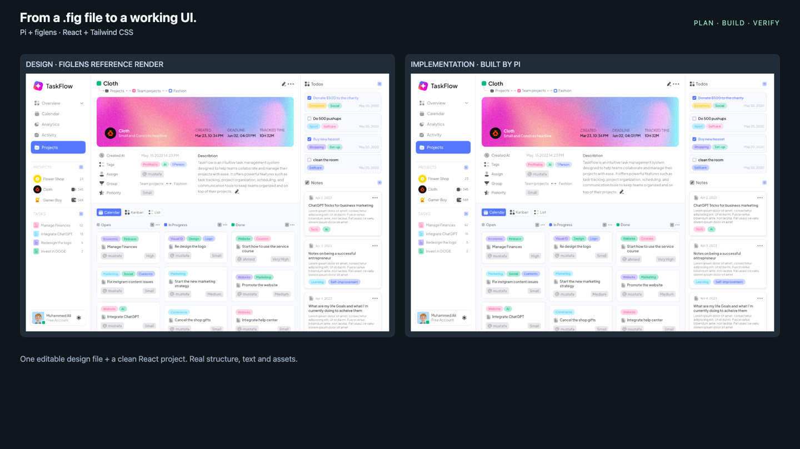

<p align="center">
  
</p>

<h1 align="center">Dein Coding-Agent liest Figma-Dateien.<br>Keine Figma-App. Kein Login. Kein API-Kontingent.</h1>

<p align="center">
  <a href="README.md">English</a> · <a href="README-de.md">Deutsch</a> · <a href="README-es.md">Español</a> · <a href="README-fr.md">Français</a> · <a href="README-ja.md">日本語</a> · <a href="README-ko.md">한국어</a> · <a href="README-pt-BR.md">Português</a> · <a href="README-zh-CN.md">简体中文</a> · <a href="README-zh-TW.md">繁體中文</a>
</p>

<p align="center">
  <a href="LICENSE"></a>
  <a href="https://github.com/runkids/figlens/releases"></a>
  <a href="https://www.npmjs.com/package/@runkids/figlens"></a>
  <a href="#mcp-and-skill"></a>
</p>

<p align="center">
  <a href="#start">Start</a> · <a href="#demo">Demo</a> · <a href="#why">Warum</a> · <a href="#bundle">Was der Agent bekommt</a> · <a href="#pi">Pi</a> · <a href="#limitations">Einschränkungen</a>
</p>

**Das Problem.** Dein Agent braucht Layoutwerte, Text und Assets, um einen Bildschirm umzusetzen. Auf einem Remote-Host oder in CI muss dieser Designkontext neben dem Code verfügbar sein, ohne eine laufende Desktop-App vorauszusetzen.

**Die Lösung.** Wähle in Figma **File > Save local copy**. Lege `design.fig` neben deinen Code. figlens parst die Datei lokal und gibt deinem Agent Layout, Text, Stile, Variablen, Icons, Bilder und ein Referenz-Rendering jedes Frames. Ein natives Binary, keine Netzwerkaufrufe an Figma.

<a id="start"></a>

## Erste Schritte

Lege `design.fig` in dein Projekt und wähle dann deinen Agent.

**Claude Code** (Node.js 18+, macOS/Linux):

```sh
claude mcp add --transport stdio --scope local figlens -- npx -y @runkids/figlens mcp
```

Starte eine neue Sitzung und prüfe `/mcp`. Für den geführten Planungs-Workflow [füge den Skill hinzu](#mcp-and-skill).

**Pi** (1.3.0+): ein Paket liefert CLI, MCP, Viewer und Skill.

```sh
pi install npm:@runkids/figlens
```

**Jeder MCP-Client** (Cursor, Codex, Gemini CLI, ...):

```json
{ "mcpServers": { "figlens": { "command": "npx", "args": ["-y", "@runkids/figlens", "mcp"] } } }
```

**Kein Node.js?** Installiere das eigenständige Binary und verwende stattdessen `"command": "figlens"`:

| Plattform | Befehl |
|---|---|
| macOS / Linux | `curl -fsSL https://raw.githubusercontent.com/runkids/figlens/main/scripts/install.sh \| sh` |
| Homebrew | `brew install runkids/tap/figlens` |
| Windows (PowerShell) | `irm https://raw.githubusercontent.com/runkids/figlens/main/scripts/install.ps1 \| iex` |

Bitte dann um einen Bildschirm:

```text
Build the task board from ./design.fig in this project.
Find the matching frame, use this project's components and image workflow,
then compare the running UI with the design and fix confirmed differences.
Report missing assets and any checks you could not run.
```

Der Agent findet den Frame, baut ein Bundle mit Designdaten, Assets und einem Referenzbild und setzt den Bildschirm mit deinem Stack um. Lass dir die geänderten Dateien und den Vergleich zeigen; ein Bundle allein beweist nicht, dass die UI stimmt.

<a id="demo"></a>

## Demo: Pi baut einen React-Bildschirm aus einer .fig

[](assets/taskflow-demo.mp4)

**[78-Sekunden-Video](assets/taskflow-demo.mp4).** Pi führt `/figlens plan` aus, liest einen Dashboard-Frame aus einer lokalen `.fig`, baut ihn mit React und Tailwind CSS und prüft und korrigiert dann die laufende UI. Geschnittener Zeitraffer, kein Benchmark und kein Pixel-Perfect-Versprechen. Design: [Task Flow von Eymen Eid](https://www.figma.com/community/file/1224268866120711793) · [Aufnahmenotizen](wiki/accuracy.md#taskflow-react-and-tailwind-demo).

<a id="why"></a>

## Warum figlens statt des offiziellen Figma MCP?

Nutze **figlens**, wenn das Design als Datei wandern soll: Remote-Agents, CI, Offline-Arbeit, Übergabe zwischen Agents, unbegrenzt wiederholte Lesezugriffe. Nutze den **offiziellen Figma MCP**, wenn der Agent das Live-Design ohne Export-Schritt sehen muss.

| | figlens | Offizieller Figma MCP |
|---|---|---|
| Quelle | Exportierter `.fig`-Snapshot | Live-Figma-Dateien |
| Voraussetzung | Die Datei | Figma-Anmeldung; der Desktop-Server braucht die App |
| Rate Limits | Keine, lokales Parsen | Limits des Figma-Dienstes |
| Remote-Agent / CI | Datei kopieren, Binary ausführen | Remote-Server mit Anmeldung |
| Design-Änderungen | Neue `.fig` exportieren | Automatisch |
| Übergabe | `.fig` oder Frame-Bundle teilen | Figma-Zugriff teilen |
| Genauigkeit | Unabhängiger Parser mit [bekannten Lücken](#limitations) | Von Figma gepflegt |

Eine `.fig` zu lesen funktioniert offline. Installieren und Aktualisieren von figlens, `gs://`-Eingaben, dein Modellanbieter und die Abhängigkeiten deines Projekts brauchen weiterhin ein Netzwerk.

<a id="bundle"></a>

## Was der Agent bekommt

Ein Frame, eine Zip. Struktur zum Bauen, Assets zum Verwenden, ein Bild zum Abgleichen.

```text
frame.zip
├── context.md                Start here: instructions for your agent
├── design/
│   ├── nodes.json            Layout, text, styles and expanded instances
│   └── variables.json        Bound variables, collections, modes and aliases
├── assets/                   Image fills, SVGs and composited node renders
├── assets.json               Maps design references to asset files
├── references/screen.png     A render of the frame to compare against
├── missing-assets.json       Anything that could not be produced
└── manifest.json             File roles, media types, sizes and SHA-256 hashes
```

Brauchst du nur ein Teil? Die CLI erledigt das direkt:

```sh
npx -y @runkids/figlens find design.fig "login" --type FRAME     # Frame-IDs nach Name oder Text
npx -y @runkids/figlens inspect design.fig 12:345                 # kompakte Layout- und Textzusammenfassung
npx -y @runkids/figlens nodes design.fig 12:345 > frame.json      # JSON im REST-Format
npx -y @runkids/figlens export design.fig 12:345 icon.svg         # SVG, PNG, JPG, WebP oder AVIF
npx -y @runkids/figlens bundle design.fig 12:345 frame.zip        # die Zip von oben
```

SVG-Exporte betten originale Bildfüllungen ein und wandeln Text in Glyphen-Umrisse um, daher werden keine Schriften benötigt. Über MCP kommen Raster-Exporte außerdem als Inline-Bilder zurück, sodass der Agent das Design sieht, ohne eine Datei zu öffnen.

### Wie nah ist es an Figma?

Gemessen an Figmas eigenen JSON-, PNG- und SVG-Exporten für **826 Produktions-Frames** und fünf Community-Dateien (2026-10-22):

| Prüfung | Ergebnis |
|---|---|
| Knotenstruktur, Namen, Sichtbarkeit, Bounds und Text | Identisch in 771 / 826 Frames |
| Originale Bildfüllungen | 2.608 / 2.608 byte-identisch |
| SVG-Assets | 5.014 / 5.197 innerhalb des Pixelabweichungs-Schwellenwerts |
| Community-Frame-Bundles | 306 / 306 ohne fehlende Assets |

Ergebnisse für diese Dateien, keine Garantie für jedes Design. Methode und Schwellenwerte: [Genauigkeitsbericht](wiki/accuracy.md).

<a id="pi"></a>

## Pi-Extension

```sh
pi install npm:@runkids/figlens
```

Starte Pi neu oder führe `/reload` aus und bitte dann in normalen Worten um einen Bildschirm. Pi findet den Frame, liest ihn über den automatisch registrierten MCP-Server und baut mit deinem Stack. Keine Node-IDs, keine globale CLI.

- `/figlens plan <request>` erstellt nur einen Plan und ändert die Anwendung nicht.
- `/figlens yolo <request>` plant, baut, prüft und räumt den eigenen temporären Plan auf.
- `/figlens preview [description]` öffnet den lokalen Viewer.
- `/figlens review` genehmigt wiederverwendbare Komponenten-Zuordnungen, die der Agent vorgeschlagen hat.


Vollständige Anleitung, Befehle und Grenzen: [pi/README.md](pi/README.md).

<a id="viewer"></a>

## Ein Design ohne Figma durchsuchen

[](assets/pi-demo.mp4)

```sh
npx -y @runkids/figlens preview design.fig                        # lokaler Viewer, Ctrl+C zum Beenden
npx -y @runkids/figlens preview design.fig 12:345 --out preview.html   # Offline-HTML-Snapshot zum Weitergeben an jeden
```

Durchsuche Seiten und Layer, suche, miss, inspiziere Layout, Typografie, Variablen und CSS, exportiere jeden Layer, kopiere einen Implementierungs-Prompt oder lade ein Bundle für die Auswahl herunter. Lege einen Screenshot deines Builds über das Design, um beide zu überlagern. Details: [Preview-Anleitung](wiki/preview.md).

<a id="mcp-and-skill"></a>

## MCP-Server und Agent-Skill

<details>
<summary>MCP-Tools, Pfadbeschränkungen, Skill-Installation, skillshare</summary>

**MCP.** Der Server läuft lokal über stdio und stellt `tree`, `find`, `inspect`, `nodes`, `variables`, `bundle` und `export` bereit. Übergib absolute Pfade. Mit `--root /path/to/designs` (wiederholbar) beschränkst du jeden Datei- und Ausgabepfad auf ausgewählte Ordner. Raster-Exporte werden auf `maxSize` (Standard 1600 px) verkleinert, damit Inline-Bilder klein bleiben; SVG liefert nur Metadaten.

Natives Windows mit Claude Code: folge dessen [stdio-Setup-Hinweisen](https://code.claude.com/docs/en/mcp#option-3-add-a-local-stdio-server) und dem `cmd /c`-Wrapper für `npx`.

**Skill.** Der [figlens-Skill](skills/figlens/SKILL.md) bringt einem Agent bei, Frames zu finden, das Bundle in kleinen Teilen zu lesen, begrenzte Arbeit zu planen und die laufende UI gegen das Design zu prüfen. Er installiert nur Anweisungen; die CLI oder der MCP-Server muss verfügbar sein. Installiere ihn mit der [Skills CLI](https://github.com/vercel-labs/skills) oder kopiere `skills/figlens/` in das Skills-Verzeichnis deines Agents (Claude Code: `~/.claude/skills/`):

```sh
npm install -g @runkids/figlens
npx skills add runkids/figlens --skill figlens
```

**skillshare.** Verwalte den Skill und die MCP-Verbindung für Claude Code, Codex und Cursor zentral mit [skillshare](https://github.com/runkids/skillshare):

```sh
skillshare install github.com/runkids/figlens/skills/figlens
skillshare mcp add figlens --global --target claude --target codex --target cursor --no-tui -- npx -y @runkids/figlens mcp
skillshare sync && skillshare sync mcp --global
```

**Installationshinweise.** Der npm-Launcher lädt beim ersten Aufruf das passende native Binary herunter, prüft es gegen die SHA-256-Prüfsummen des Releases und legt es im Cache ab. Eigenständige Installationen aktualisieren sich mit `figlens update`. Die Binaries decken macOS (Apple Silicon, Intel), Linux (arm64, x86_64, statisch mit musl) und Windows (x86_64) ab.

</details>

<a id="commands"></a>

## CLI-Referenz

<details>
<summary>Alle Befehle</summary>

| Befehl | Ausgabe |
|---|---|
| `tree <file> [node] [--depth N] [--json]` | Node-IDs, Typen und Namen; eingerückter Text oder verschachteltes JSON |
| `find <file> <query> [--type TYPE] [--node ID] [--limit N]` | Suche über Layer-Namen und Text ohne Beachtung der Groß-/Kleinschreibung; Pfade, Größen und Vorschauen. Standardmäßig 20 Ergebnisse (1-200) |
| `inspect <file> <node> [--depth N] [--images]` | Kompakte Zusammenfassung des expandierten Layouts/Texts, höchstens 200 Nodes. `--images` ergänzt Bitmap-Abmessungen und Crop-Footprints |
| `nodes <file> <node>` | JSON im REST-Format: expandierte Instanzen und Overrides, Auto-Layout, Textstile, Füllungen, Effekte, gebundene Variablen, Komponenten-Eigenschaften, Render-Bounds |
| `variables <file> [node]` | Die gebundenen Variablen eines Frames; ohne Node alle lokalen Variablen |
| `bundle <file> <node> <out.zip>` | Ein Design-Bundle für einen Frame; gibt `{nodeId, path, warnings}` aus |
| `bundle <file> --frames <list> --out-dir <dir> [--jobs N]` | Viele Bundles aus einem Decode, parallel |
| `export <file> <node> <out> [--scale N] [--quality 1-100] [--max-kb N] [--max-size N]` | SVG, PNG, JPG, WebP oder AVIF; `--max-kb` senkt die verlustbehaftete Qualität, bis es passt |
| `preview <file> [node] [--out preview.html] [--port N] [--bind IP]` | Lokaler schreibgeschützter Viewer; `--out` schreibt einen eigenständigen Offline-Snapshot |
| `compare <file> <nodes.json> <node>` | Diff gegen einen REST-Export desselben Frames |
| `node <file> <node>` | Ein roher `.fig`-Node |
| `mcp` | Lokaler MCP-Server über stdio |
| `update` | Ersetzt das Binary durch das neueste Release |

Ein Node-Argument akzeptiert `12:345`, `12-345` oder eine Figma-URL mit `?node-id=`. `<file>` kann auch `gs://bucket/object` sein, heruntergeladen mit deinem `gcloud`-Login und im Cache abgelegt. Jeder CLI-Aufruf decodiert die Datei; der MCP-Server behält die geparste Datei über Aufrufe hinweg, bis sie sich auf dem Datenträger ändert. Führe `figlens --help` für die Nutzung aus.

</details>

<a id="limitations"></a>

## Einschränkungen

- **Snapshots, keine Live-Synchronisierung.** Exportiere eine neue `.fig`, wenn sich das Design ändert. figlens kann kein Design über eine Figma-URL herunterladen.
- **Undokumentiertes Format.** figlens decodiert das in der Datei eingebettete Schema; neue Figma-Exporte können ein figlens-Update erfordern.
- **Noch nicht ausgegeben:** Dev-Mode-Annotationen, Constraints, layoutAlign/layoutGrow, Layout-Raster, Definitionen von Komponenten-Eigenschaften.
- **Render-Lücken:** Hintergrundunschärfe und einige Bildanpassungen werden übersprungen; Angular- und Diamant-Verläufe werden als radial gezeichnet. Überschriebener Text kann Figmas letztes Layout behalten. Schriftdateien sind nicht enthalten.
- **Prüfe die Ausgabe.** Lies die Bundle-`warnings`, `missing-assets.json` und ungelöste Variablen in `context.md` und vergleiche dann die Implementierung mit dem Design.

## Hilf figlens zu wachsen

Wenn figlens für dich ein Design in Code verwandelt hat, [gib dem Repo einen Stern](https://github.com/runkids/figlens), damit andere es finden. Eine Datei, die figlens nicht lesen kann? [Eröffne ein Issue](https://github.com/runkids/figlens/issues) mit dem Befehl und deiner Erwartung.

Die Entwicklung führt Rust ausschließlich in Docker aus: `docker compose run --rm dev cargo test`. Siehe [AGENTS.md](AGENTS.md) und das [Wiki](wiki/README.md).

## Lizenz

[MIT](LICENSE). figlens ist ein unabhängiges Projekt und steht in keiner Verbindung zu Figma, wird nicht von Figma unterstützt und nicht von Figma gesponsert. Das `.fig`-Format ist undokumentiert und kann sich ändern; verwende nur Dateien und Assets, auf die du zugreifen und die du teilen darfst.
