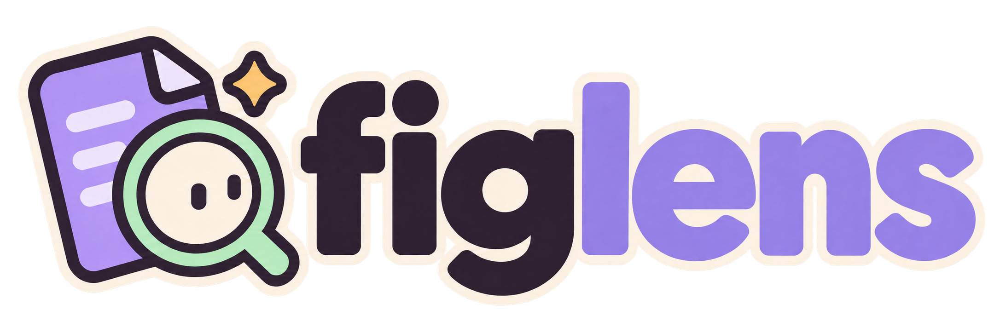
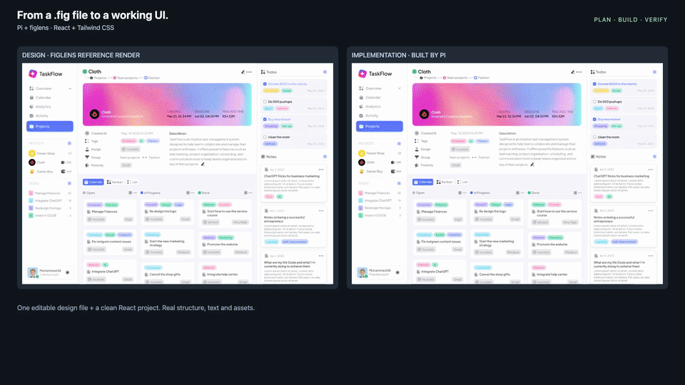

<p align="center">
  
</p>

<h1 align="center">Votre coding agent lit les fichiers Figma.<br>Sans app Figma. Sans connexion. Sans quota d’API.</h1>

<p align="center">
  <a href="README.md">English</a> · <a href="README-de.md">Deutsch</a> · <a href="README-es.md">Español</a> · <a href="README-fr.md">Français</a> · <a href="README-ja.md">日本語</a> · <a href="README-ko.md">한국어</a> · <a href="README-pt-BR.md">Português</a> · <a href="README-zh-CN.md">简体中文</a> · <a href="README-zh-TW.md">繁體中文</a>
</p>

<p align="center">
  <a href="LICENSE"></a>
  <a href="https://github.com/runkids/figlens/releases"></a>
  <a href="https://pi.dev/packages/@runkids/figlens"></a>
  <a href="#mcp-and-skill"></a>
</p>

<p align="center">
  <a href="#start">Démarrer</a> · <a href="#demo">Démo</a> · <a href="#why">Pourquoi</a> · <a href="#bundle">Ce que reçoit l’agent</a> · <a href="#pi">Pi</a> · <a href="#limitations">Limites</a>
</p>

**Le problème.** Votre agent a besoin des valeurs de mise en page, du texte et des ressources pour réaliser un écran. Sur une machine distante ou en CI, ce contexte doit être disponible à côté du code, sans dépendre d’une application desktop en cours d’exécution.

**La solution.** Dans Figma, **File > Save local copy**. Placez `design.fig` à côté de votre code. figlens l’analyse en local et donne à votre agent la mise en page, le texte, les styles, les variables, les icônes, les images et un rendu de référence de n’importe quelle frame. Un seul binaire natif, aucun appel réseau vers Figma.

<a id="start"></a>

## Bien démarrer

**Pas encore de fichier de design ?** [Vérifiez votre installation avec le petit exemple public](examples/first-success/README.md) : vérifiez le binaire choisi, trouvez un frame et validez son bundle. Aucun modèle nécessaire.

Placez `design.fig` dans votre projet, puis choisissez **une** configuration. Chacune donne à votre agent les outils figlens et le même guide intégré pour la planification, l'implémentation et la préparation des images.

| Configuration | Pour | Le guide vient de |
|---|---|---|
| [MCP](#setup-mcp) | Claude Code, Cursor, Codex, Gemini CLI et les autres clients MCP | l'outil `workflow` du serveur |
| [Pi](#setup-pi) | Pi 1.3.0+ | le paquet, qui inclut le skill |
| [CLI](#setup-cli) | les agents qui n'exécutent que des commandes shell, les scripts et la CI, ou vous | `figlens workflow <topic>`, ou le [skill](#setup-skill) facultatif |

<a id="setup-mcp"></a>

### MCP

**Claude Code** (Node.js 18+, macOS/Linux) :

```sh
claude mcp add --transport stdio --scope local figlens -- npx -y @runkids/figlens mcp
```

**Codex CLI** (Node.js 18+, macOS/Linux) :

```sh
codex mcp add figlens -- npx -y @runkids/figlens mcp
```

**Tout client MCP :**

```json
{
  "mcpServers": {
    "figlens": {
      "command": "npx",
      "args": ["-y", "@runkids/figlens", "mcp"]
    }
  }
}
```

Sans Node.js, installez le binaire autonome ([CLI](#setup-cli)) et utilisez `"command": "figlens", "args": ["mcp"]`. Ouvrez une nouvelle session et vérifiez que les outils figlens apparaissent (`/mcp` dans Claude Code). Aucune installation séparée du skill n'est nécessaire. Ajoutez `--root <dir>` après `mcp` pour limiter les dossiers que figlens peut lire et écrire.

<a id="setup-pi"></a>

### Pi

Un seul paquet fournit la CLI, MCP, le viewer, les commandes `/figlens` et le skill :

```sh
pi install npm:@runkids/figlens
```

[Guide de l'extension Pi](docs/README-fr.md#pi)

<a id="setup-cli"></a>

### CLI

Lancez-le via npm, ou installez le binaire autonome :

```sh
npx @runkids/figlens --help                                                                # Node.js 18+, sans installation
curl -fsSL https://raw.githubusercontent.com/runkids/figlens/main/scripts/install.sh | sh  # macOS, Linux
brew install runkids/tap/figlens                                                           # Homebrew
irm https://raw.githubusercontent.com/runkids/figlens/main/scripts/install.ps1 | iex      # Windows PowerShell
```

`npx` exécute le binaire de la version du paquet qu'il résout. Les installations par script se mettent à jour avec `figlens update`, celles de Homebrew avec `brew upgrade figlens`. Les binaires couvrent macOS (Apple silicon, Intel), Linux (arm64, x86_64) et Windows (x86_64).

Un agent qui utilise la CLI lit son guide avec `figlens workflow build` (ainsi que `audit`, `images`, `plan`, `planning-details` et `yolo`, réservé à une demande explicite), toujours aligné sur la version du binaire, ou via le [skill](#setup-skill).

[Référence de la CLI](docs/README-fr.md#commands)

<a id="setup-skill"></a>

### Skill pour agents (facultatif)

Le skill enseigne à un agent le même déroulé que le guide intégré : trouver le frame, lire le bundle par petits morceaux, planifier le périmètre et comparer l'UI en cours d'exécution avec le design. Il ne contient que des instructions : associez-le à la CLI ou à MCP. Les configurations MCP et Pi n'en ont pas besoin.

**Recommandé : [skillshare](https://github.com/runkids/skillshare).** Installez le skill une fois et synchronisez-le avec chaque agent que vous utilisez :

```sh
skillshare install github.com/runkids/figlens/skills/figlens
skillshare sync
```

Le même outil peut aussi configurer la connexion MCP de figlens pour ces agents :

```sh
skillshare mcp add figlens --global --target claude --target codex --target cursor --no-tui -- npx -y @runkids/figlens mcp
skillshare sync mcp --global
```

Autres façons d'installer le skill :

```sh
npx skills add runkids/figlens --skill figlens   # Skills CLI
```

Ou copiez `skills/figlens/` depuis ce dépôt ou une archive de release dans le répertoire de skills de votre agent (Claude Code : `~/.claude/skills/`). Un skill installé se met à jour séparément du binaire ; `figlens workflow` correspond toujours au binaire.

Demandez ensuite un écran :

```text
Build the task board from ./design.fig in this project.
Find the matching frame, use this project's components and image workflow,
then compare the running UI with the design and fix confirmed differences.
Report missing assets and any checks you could not run.
```

L’agent trouve la frame, regroupe les données de design, les assets et une image de référence, puis construit l’écran avec votre stack. Le workflow partagé guide les vérifications des polices et des ressources ; les éléments manquants sont signalés pendant que l’implémentation de la mise en page continue avec des alternatives documentées. Demandez les fichiers modifiés et une comparaison dans le navigateur.

<a id="demo"></a>

## Démo : Pi construit un écran React à partir d’un .fig

[](assets/taskflow-demo.mp4)

Le GIF en boucle lit la vidéo montée à une vitesse trois fois supérieure. Cliquez pour voir la vidéo complète de 78 secondes.

**[Vidéo de 78 secondes](assets/taskflow-demo.mp4).** Pi lance `/figlens plan`, lit une frame de dashboard dans un `.fig` local, la construit avec React et Tailwind CSS, puis vérifie et corrige l’UI en cours d’exécution. Time-lapse monté, pas un benchmark ni une promesse de fidélité au pixel près. Design : [Task Flow par Eymen Eid](https://www.figma.com/community/file/1224268866120711793) · [notes d’enregistrement](wiki/accuracy.md#taskflow-react-and-tailwind-demo).

**[Du .fig au HTML/CSS modifiable](examples/task-list/README.md) :** dans une étude contrôlée sur une liste de tâches, les six essais basés sur figlens ont conservé les 19 occurrences de texte visible comme véritable texte DOM et les quatre icônes. L’extraction CLI et MCP a également réussi avec le réseau Docker désactivé. L’étude présente la configuration, les mesures et les comparaisons d’images indépendantes.

<a id="why"></a>

## Pourquoi figlens plutôt que le MCP Figma officiel ?

Utilisez **figlens** quand le design doit voyager sous forme de fichier : agents distants, CI, travail hors ligne, passation entre agents, lectures répétées illimitées. Utilisez le **MCP Figma officiel** quand l’agent doit voir le design en direct, sans étape d’export.

La lecture d’un `.fig` se fait hors ligne. L’installation et la mise à jour de figlens, les entrées `gs://`, votre fournisseur de modèle et les dépendances de votre projet nécessitent toujours un réseau.

[Comparaison complète](docs/README-fr.md#why)

<a id="bundle"></a>

## Ce que reçoit l’agent

Une frame, un zip. Une structure pour construire, des assets à utiliser, une image pour vérifier.

[Contenu du bundle et exemples](docs/README-fr.md#bundle) · [Quelle est la proximité avec Figma ?](docs/README-fr.md#accuracy)

## Documentation

- <a id="pi"></a>[Extension Pi](docs/README-fr.md#pi)
- <a id="viewer"></a>[Parcourir un design sans Figma](docs/README-fr.md#viewer)
- <a id="mcp-and-skill"></a>[Serveur MCP et skill pour agent](docs/README-fr.md#mcp-and-skill)
- <a id="commands"></a>[Référence de la CLI](docs/README-fr.md#commands)

<a id="limitations"></a>

## Limites

- **Des snapshots, pas une synchronisation en direct.** Exportez un nouveau `.fig` quand le design change. figlens ne peut pas télécharger un design depuis une URL Figma.
- **Format non documenté.** figlens décode le schéma embarqué dans le fichier ; les nouveaux exports Figma peuvent nécessiter une mise à jour de figlens.
- **Polices et texte :** les fichiers de polices ne sont pas inclus ; un texte avec override peut conserver la mise en page enregistrée par Figma. Utilisez des polices autorisées du projet et comparez le résultat.
- **Couverture :** les [améliorations du rendu](https://github.com/runkids/figlens/issues/36) et la [sémantique de transmission](https://github.com/runkids/figlens/issues/37) sont suivies dans les issues. Consultez la [couverture sémantique actuelle](wiki/semantics.md).
- **Vérifiez la sortie.** Lisez les `warnings` du bundle, `missing-assets.json` et les variables non résolues dans `context.md`, puis comparez l’implémentation au design.
- Les limites de rendu visibles connues figurent dans `_figlens.renderDiagnostics` des nœuds, les résumés bornés de `inspect` et les `warnings` du bundle ; `missing-assets.json` ne contient que les échecs de ressources. L’absence d’avertissements ne garantit pas la fidélité des pixels.

## Aidez figlens à grandir

Si figlens a transformé un design en code pour vous, [mettez une étoile au repo](https://github.com/runkids/figlens) pour que d’autres le trouvent. Un fichier qu’il ne sait pas lire ? [Ouvrez une issue](https://github.com/runkids/figlens/issues) avec la commande et le résultat attendu.

Le développement fait tourner Rust uniquement dans Docker : `docker compose run --rm dev cargo test`. Voir [AGENTS.md](AGENTS.md) et le [wiki](wiki/README.md).

## Licence

[MIT](LICENSE). figlens est un projet indépendant, non affilié à Figma, ni approuvé ou sponsorisé par Figma. Le format `.fig` n’est pas documenté et peut changer ; n’utilisez que des fichiers et des assets que vous avez le droit d’utiliser et de partager.
