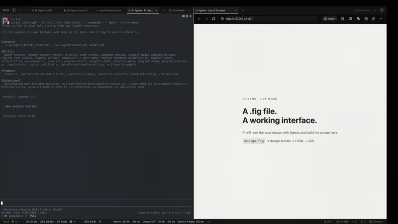
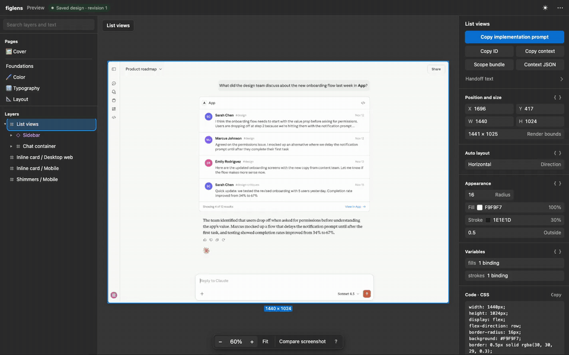

<p align="center">
  
</p>

<h1 align="center">讓你的 coding agent，直接從 Figma 設計開始。</h1>

<p align="center">
  <a href="README.md">English</a> · <a href="README-de.md">Deutsch</a> · <a href="README-es.md">Español</a> · <a href="README-fr.md">Français</a> · <a href="README-ja.md">日本語</a> · <a href="README-ko.md">한국어</a> · <a href="README-pt-BR.md">Português</a> · <a href="README-zh-CN.md">简体中文</a> · <a href="README-zh-TW.md">繁體中文</a>
</p>

<p align="center">
  把任何畫面的版面、文字、變數、素材與參考圖交給你的 coding agent。<br>
  在筆電、雲端或 CI 上，想讀幾次就讀幾次。<br>
  <strong>執行工作的機器不需要 Figma App、登入、seat，也沒有 API 速率限制。</strong>
</p>

<p align="center">
  <a href="LICENSE"></a>
  <a href="#for-ai-agents"></a>
</p>

<p align="center">
  <a href="#from-a-local-fig-to-working-html">觀看示範</a> · <a href="#quick-start">試試你的設計</a> · <a href="#for-ai-agents">連接 agent</a> · <a href="#pi-extension">搭配 Pi 使用</a> · <a href="#how-close-is-it-to-figma">準確度</a>
</p>

<a id="why-figlens"></a>

## 為什麼使用 figlens？

當你說「做出這個畫面」，agent 應該同時拿到它的版面、文字與素材。只有截圖時，agent 得估算間距與字體樣式，圖示還是要你手動匯出。Figma MCP server 讀的是真實設計，但配額綁在檔案所屬的團隊上，agent 一個 prompt 就可能用光一天的配額，而且機器必須登入 Figma。

figlens 改從儲存的副本讀取設計。在 Figma 選擇 **File > Save local copy**（只要擁有者沒有關閉複製，檢視權限就夠）。把這個 `.fig` 透過 CLI 或本機 MCP server 交給 agent，它就能尋找畫面、檢視版面與文字，並擷取所需素材。也可以把一個 frame 的設計資料、素材與參考圖打包成一個 zip，任何 agent 或隊友都能使用。

| 如果你遇過這些情況 | figlens 可以幫你 |
|---|---|
| 付費 seat 也遇到「Rate limit exceeded, try again tomorrow」 | 隨時讀取儲存的檔案，不呼叫 Figma API，不需要 token 或 seat |
| agent 在雲端伺服器或 CI 執行 | 使用原生 CLI 讀取設計，不需要 Figma App 或瀏覽器工作階段 |
| 不斷解釋尺寸、匯出素材 | 提供結構化版面、字體樣式、展開的 instance、綁定變數與原始素材 |
| 其他 agent 或隊友需要相同畫面 | 分享包含設計資料、素材、參考圖與說明的 frame bundle |

設計師繼續使用 Figma，agent 使用專案既有的技術堆疊。figlens 提供設計上下文，coding agent 負責撰寫實作。

<details>
<summary>.fig 格式沒有公開文件。Figma 改了格式怎麼辦？</summary>

figlens 不靠猜測格式。每個版本都用同一批檔案對照 Figma 自己匯出的 JSON、PNG 與 SVG 檢查（[結果](#how-close-is-it-to-figma)），所以格式變動會以可量測的回歸顯現，而不是悄悄出錯。你已經儲存的副本，用讀取它的那個 figlens 版本仍可繼續使用；只有從改版後的 Figma 新儲存的檔案才需要更新 figlens，`figlens update` 就能取得。

</details>

<a id="from-a-local-fig-to-working-html"></a>

## 從本機 .fig 到可操作的 HTML

[](assets/demo-8x.mp4)

**[觀看影片](assets/demo-8x.mp4)** · 45 秒縮時影片，**8 倍速**。這是在 Orca 中進行的真實 Pi 工作階段：讀取本機設計、建立 HTML/CSS，再於即時預覽中操作分享對話框與輸入區。介面使用 bundle 內的 19 個 SVG 圖示，是 HTML 實作。

| 此範例 | 實測結果 |
|---|---|
| 本機 `.fig` 檔案 | 57.5 MiB |
| 選取的 frame | 153 個節點、25 個 SVG 素材，無缺失素材 |
| 擷取設計 bundle | 五次暖快取執行的中位數為 **0.47 秒** |

計時測量的是 `figlens bundle`，**不包含 AI 實作時間**。使用 figlens 0.1.2，在 ARM64 Docker 容器中測量；詳見[指令、各次結果與錄影說明](wiki/accuracy.md#local-design-to-html-demo)。Pi 撰寫程式碼，figlens 提供設計資料；AI 服務仍需網路連線。

<details>
<summary>設計出處與示範限制</summary>

「List views」frame 來自 [MCP Apps for Claude (Community)](https://www.figma.com/community/file/1597641111449594397/mcp-apps-for-claude)。原始 Anthropic 字型未包含在 bundle 中，因此示範使用系統 sans 與 Georgia。分享按鈕開啟本機對話框；回覆保留於頁面，重新載入即清除。錄影由真實 Orca 視窗的連續截圖組成，動態效果較一般錄影不流暢。

</details>

<a id="quick-start"></a>

## 快速開始

<a id="1-open-your-design-locally"></a>

### 1. 在本機開啟設計

在 Figma 選擇 **File > Save local copy**，儲存為 `design.fig`，接著執行：

```sh
npx @runkids/figlens preview design.fig
```

開啟終端顯示的本機網址，瀏覽頁面並選取要實作的畫面。你可以直接檢視間距、字體樣式、變數與素材。

需要 Node.js 18+。首次執行會下載、驗證並快取原生執行檔。[獨立安裝](#installation)不需要 Node.js、Rust 或 Docker。按 Ctrl+C 停止 viewer。

<a id="2-give-the-screen-to-your-agent"></a>

### 2. 將畫面交給 agent

從 viewer 下載選取 frame 的 bundle，將 zip 和這段提示交給 coding agent：

> 將此 bundle 解壓縮到獨立目錄並閱讀 context.md。依照此專案的技術堆疊與慣例實作這個畫面。使用提供的版面數值與素材，並以 references/screen.png 檢查成果。回報缺失素材或無法取得的字型。

bundle 包含結構、素材與參考圖，agent 可透過一般檔案工具閱讀。若要讓它直接尋找與檢視畫面，請[連接 CLI 或 MCP server](#for-ai-agents)。[Pi 使用者可以直接指定畫面名稱](#pi-extension)。

<a id="3-check-the-implementation"></a>

### 3. 檢查實作成果

將實作畫面的截圖匯入 viewer，與設計並排比較，或透過透明度疊圖找出差異。截圖只留在瀏覽器中。這是視覺檢查；figlens 不會為實作計算準確度分數。

**`.fig` 是快照。** 設計變更後，請重新儲存本機副本。Figma 網址只能選取該副本中的節點，不能用來下載設計。安裝完成後可離線讀取檔案；AI 服務與專案相依套件仍可能需要網路連線。

<details>
<summary>偏好終端操作？直接尋找 frame 並打包。</summary>

```sh
npx @runkids/figlens tree design.fig --depth 2
npx @runkids/figlens find design.fig "login" --type FRAME
npx @runkids/figlens inspect design.fig 12:345 --depth 1
npx @runkids/figlens bundle design.fig 12:345 frame.zip
```

將 `12:345` 換成樹狀清單或搜尋結果中的 ID。節點可使用 ID（`12:345`）、網址格式（`12-345`）或帶有 `?node-id=` 的 Figma 網址。用 `find` 搜尋圖層名稱或文字；用 `inspect` 檢視展開的 instance 子節點與精簡的版面／文字摘要。輸出細節請見[指令](#commands)。

</details>

<a id="browse-and-hand-off-a-design"></a>

## 瀏覽與交接設計

[](assets/pi-demo.mp4)

本機 viewer 讓你無需 Figma 工作階段就能探索儲存的設計：

- 瀏覽頁面與圖層、搜尋名稱與文字、量測距離，並檢視版面、字體樣式、變數、元件屬性與 CSS。
- 將選取圖層匯出為 SVG、PNG、JPG、WebP 或 AVIF，或下載其原始填色圖片。
- 複製圖層 ID、結構化上下文或實作提示；下載涵蓋精確選取範圍的 bundle，包含 instance 子圖層。

想讓其他人也能瀏覽設計？匯出獨立 HTML 快照：

```sh
npx @runkids/figlens preview design.fig 12:345 --out preview.html
```

它不需要伺服器或網路即可開啟，內含設計資料、圖片與快照範圍的 bundle。僅分享給有權查看素材的人。選取子節點會改變檢視內容；內嵌 bundle 仍涵蓋原本的快照範圍。

即時 viewer 監看儲存的本機檔案，儲存成功後更新；部分寫入或儲存失敗會標記畫面資料已過期。HTML 快照維持不變。操作方式、快取管理、瀏覽器 agent 自動化與限制請見[預覽指南](wiki/preview.md)。

<a id="pi-extension"></a>

## Pi 擴充套件

**給 Pi 一個 `.fig`，告訴它要哪個畫面。** 套件包含 CLI、MCP、preview、擴充功能與 agent skill：

```sh
pi install npm:@runkids/figlens
```

重新啟動 Pi 或執行 `/reload`，接著用一般語句提出要求：

```text
Build the List views screen from ./design.fig using this project's components.
Show me the result and check it against the design.
```

Pi 會尋找畫面、讀取版面與素材、檢視專案，並使用現有技術堆疊實作。不需知道 frame ID，也不必執行 `/figlens open`。名稱有歧義時，Pi 可列出少量候選項目。MCP 會自動啟動，不需全域安裝 CLI。


**選用的元件重用：** 請 Pi 儲存可重用的對應，再用 `/figlens review` 接受或編輯專案中的待審提案。決策存放於 `.figlens/component-mappings.md`；variant 或記錄的程式碼變更後需重新審查。實作畫面不需要先建立對應。

[](assets/pi-demo.mp4)

**[觀看選用的對應流程](assets/pi-demo.mp4)** · v0.3.0 的 20 秒剪輯錄影：檢視 MCP Apps 設計、核准預先準備的既有 HTML 對應，再於新工作階段重用。未展示或計時模型生成。[完整流程、指令與限制](pi/README.md) · [錄影與驗證說明](wiki/pi.md#demo-and-verification)。

需要 Pi 1.3.0+。npm 擴充套件使用隨附的 CLI launcher；首次啟動（包含自動啟動 MCP）會下載並驗證對應的原生執行檔。Homebrew 與 release 壓縮檔提供原生 CLI 和 viewer。開發設定請見[原始碼安裝說明](pi/README.md#install-once)。

<a id="the-design-bundle"></a>

## 設計 bundle

一個 frame，一份 zip。內含實作所需的結構、可使用的素材，以及用來比對的圖片。

```text
frame.zip
├── context.md                Start here: instructions for your agent
├── design/
│   ├── nodes.json            Layout, text, styles and expanded instances
│   └── variables.json        Bound variables, collections, modes and aliases
├── assets/                   Image fills, SVGs and composited node renders
├── assets.json               Maps design references to asset files
├── references/screen.png     A render of the frame to compare against
├── missing-assets.json       Anything that could not be produced
└── manifest.json             File roles, media types, sizes and SHA-256 hashes
```

只需要其中一部分？直接匯出 JSON 或渲染節點：

```sh
npx @runkids/figlens nodes design.fig 12:345 > frame.json
npx @runkids/figlens variables design.fig 12:345 > variables.json
npx @runkids/figlens export design.fig 12:345 icon.svg
npx @runkids/figlens export design.fig 12:345 hero.webp --scale 2 --quality 80
```

SVG 匯出支援 frame、群組、圖示與精確的 instance 子圖層：選取的子樹會產生單一獨立 SVG，嵌入原始填色圖片，文字以字形輪廓表示。不需解壓 bundle。SVG 維持原始尺寸；`--scale` 與 `--quality` 僅適用點陣格式。透過 MCP 匯出的點陣圖會縮小到 `maxSize` 以內（預設最長邊 1600 px，0 表示不限制），讓內嵌圖片保持小巧。

<a id="how-close-is-it-to-figma"></a>

## 與 Figma 有多接近？

figlens 以 Figma 自身匯出的 JSON、PNG 和 SVG 驗證。以下是 **826 個正式設計 frame** 與 **五個 Community 檔案**的記錄結果：

| 檢查項目 | 結果 |
|---|---|
| 節點結構、名稱、可見性、邊界與文字 | 771 / 826 個正式設計 frame 完全一致 |
| 原始填色圖片 | 2,608 / 2,608 位元組完全一致 |
| SVG 素材 | 5,014 / 5,197 在像素差異門檻內 |
| Community frame bundle | 306 / 306 無缺失素材 |

這些是對上述檔案的測量結果，不保證每個設計皆相同。日期、門檻、渲染結果與方法請見[準確度報告](wiki/accuracy.md)。

**已知限制：** 尚未輸出 constraints、layoutAlign/layoutGrow、layout grids 與 component property definitions。渲染會略過背景模糊與部分圖片調整（對比、色溫、色調、亮部、陰影），並以放射漸層繪製角度與菱形漸層。文字使用已儲存的字形輪廓，因此渲染不需字型檔，但覆寫文字可能保留 Figma 上次的版面。實作所需的字型檔不包含在內。

<a id="for-ai-agents"></a>

## 給 AI agents

透過 agent skill 使用 CLI，或將同一個執行檔接成 MCP server。

### Agent skill

[figlens skill](skills/figlens/SKILL.md) 教 agent 尋找 frame、分段閱讀 bundle，並依照其中的數值實作。

需要仔細還原設計時，[規劃流程](skills/figlens/references/planning.md)會把本次範圍對應到既有程式、圖片交付與驗收條件。Pi 也提供 `/figlens plan <request>`，先規劃再實作；小範圍維持小任務。使用 `/figlens open [description]` 描述你知道的內容，Pi 會補問缺少的資訊，不需要你知道節點 ID。 使用 `/figlens preview [description]` 啟動本機互動 viewer 並取得連結；Pi 會辨識檔案與畫面，不需你提供節點 ID。

透過 [Skills CLI](https://github.com/vercel-labs/skills) 安裝：

```sh
npx skills add runkids/figlens --skill figlens
```

若要跨 Claude Code、Codex、Cursor、Gemini CLI 等工具管理與更新 skills，可使用 [skillshare](https://github.com/runkids/skillshare)：

```sh
skillshare install github.com/runkids/figlens/skills/figlens
skillshare sync
```

用 `skillshare update --all` 保持最新。也可將 `skills/figlens/` 複製到 agent 的 skills 目錄（Claude Code 為 `~/.claude/skills/`）。Release 壓縮檔也有附上。

### MCP server

使用 [skillshare](https://github.com/runkids/skillshare) 一起管理 MCP server 與 agent skills。定義 figlens 一次，再將連線設定同步到 Claude Code、Codex 與 Cursor：

```sh
skillshare mcp add figlens --global \
  --target claude --target codex --target cursor --no-tui -- npx -y @runkids/figlens mcp
skillshare sync mcp --global
```

其他 client 與匯入既有設定的方式，請見 [Skillshare MCP 指南](https://skillshare.runkids.cc/docs/reference/commands/mcp/)。

直接設定 Claude Code：

```sh
claude mcp add figlens -- npx -y @runkids/figlens mcp
```

其他 MCP client：

```json
{ "mcpServers": { "figlens": { "command": "npx", "args": ["-y", "@runkids/figlens", "mcp"] } } }
```

若已獨立安裝 `figlens`，請使用：

```json
{ "mcpServers": { "figlens": { "command": "figlens", "args": ["mcp"] } } }
```

要把 server 限制在指定資料夾內，加上 `--root`：`"args": ["mcp", "--root", "/path/to/designs"]`。之後工具呼叫指定的每個 `file` 與輸出路徑都必須位於某個 root 之下；多個資料夾可重複 `--root`。參數不符合工具 schema 的呼叫也會被拒絕，因為舊的參數轉換可能把任一參數當成路徑。

Server 在本機透過 stdio 執行，提供 `tree`、`find`、`inspect`、`nodes`、`variables`、`bundle` 與 `export`。工具請使用絕對路徑：相對路徑以 client 啟動 figlens 的目錄為準。

先用 `find` 與 `inspect` 選擇 frame。`export` 儲存檔案並回傳 metadata。點陣格式也會回傳 MCP 圖片內容，因此 agent 不需開啟本機檔案就能看見設計；SVG 僅回傳 metadata。PNG 的 client 支援最廣，大型 frame 可降低 `scale`。`find`、`inspect`、`bundle` 與 `export` 也會回傳結構化 JSON。

<a id="installation"></a>

## 安裝

搭配 Node.js 18+ 使用 `npx @runkids/figlens`，或安裝獨立 CLI：

| 平台 | 指令 |
|---|---|
| macOS / Linux | `curl -fsSL https://raw.githubusercontent.com/runkids/figlens/main/scripts/install.sh \| sh` |
| Homebrew | `brew install runkids/tap/figlens` |
| Windows (PowerShell) | `irm https://raw.githubusercontent.com/runkids/figlens/main/scripts/install.ps1 \| iex` |

Release 執行檔支援 macOS（Apple silicon、Intel）、Linux（arm64、x86_64、靜態 musl）與 Windows（x86_64；ARM64 透過模擬執行）。獨立安裝可用 `figlens update` 更新。

<a id="commands"></a>

## 指令

| 指令 | 輸出 |
|---|---|
| `tree <file> [node] [--depth N] [--json]` | 節點 ID、類型與名稱；縮排文字（減少 agent 上下文用量），加 `--json` 則輸出巢狀 JSON |
| `find <file> <query> [--type TYPE] [--node ID] [--limit N]` | 不分大小寫搜尋圖層名稱與文字子字串；包含路徑、尺寸與預覽。預設 20 筆（1–200）；`truncated` 表示還有結果 |
| `inspect <file> <node> [--depth N] [--images]` | 展開後的精簡版面／文字摘要。預設深度 1（0–10），最多 200 個節點；完整資料用 `nodes`。加上 `--images` 可讀取原圖像素／bytes 與各次使用的裁切像素範圍；像素數不能診斷模糊原因。 |
| `nodes <file> <node>` | REST 格式 JSON：展開的 instance 與覆寫、自動版面、文字樣式、填色、效果、綁定變數、元件屬性與渲染邊界 |
| `variables <file> [node]` | frame 綁定的變數；未指定節點時輸出所有本機變數 |
| `bundle <file> <node> <out.zip>` | 單一 frame 的設計 bundle；回傳 `{nodeId, path, warnings}` |
| `bundle <file> --frames <list> --out-dir <dir> [--jobs N]` | 解碼一次，平行產生多個 bundle；每個 frame 輸出一行 JSON，格式同上或 `{nodeId, error}` |
| `export <file> <node> <out> [--scale N] [--quality 1-100] [--max-kb N] [--max-size N]` | SVG、PNG、JPG、WebP 或 AVIF；`--max-kb` 降低有損品質至符合大小；PNG/SVG 超限會失敗；回傳 `{path, width, height, bytes, quality}` |
| `preview <file> [node] [--out preview.html] [--port N] [--bind IP]` | 本機唯讀 viewer；`--out` 需指定節點，產生獨立離線快照 |
| `compare <file> <nodes.json> <node>` | 與同一 frame 的 REST 匯出比較差異 |
| `node <file> <node>` | 單一原始 `.fig` 節點 |
| `mcp` | 透過 stdio 執行的本機 MCP server |
| `update` | 以最新 release 取代執行檔 |

`find` 搜尋儲存的圖層，回傳 ID、祖先路徑、本機尺寸與文字預覽。`inspect` 展開 instance，輸出上限為 200 個節點與每段文字 200 個字元；`truncated` 和 `textTruncated` 標示省略內容。CLI 每次呼叫都會解碼檔案；MCP server 會在呼叫之間保留已解析的檔案，直到磁碟上的檔案改變。

`<file>` 也可使用 `gs://bucket/object`，透過你的 `gcloud` 登入下載並快取。用法請執行 `figlens --help`。

<a id="help-figlens-grow"></a>

## 幫助 figlens 成長

如果 figlens 幫助你把下一個設計做成程式碼，歡迎[給它一顆星](https://github.com/runkids/figlens)，讓更多人找到它。遇到無法處理的設計？請[開 issue](https://github.com/runkids/figlens/issues)，附上執行的指令與預期結果。

開發時 Rust 僅在 Docker 中執行：`docker compose run --rm dev cargo test`。`make devc` 開啟 shell，當中的 `figlens` 執行此 checkout 的原始碼；`make help` 列出容器目標。VS Code 的 Reopen in Container 使用相同服務。專案規範請見 [AGENTS.md](AGENTS.md)，技術主題請見 [wiki](wiki/README.md)。

<a id="license"></a>

## 授權

[MIT](LICENSE)。figlens 是獨立專案，與 Figma 無隸屬、背書或贊助關係。`.fig` 格式未公開文件，可能隨時變更；figlens 讀取你從自己的 Figma 帳號儲存的檔案。
