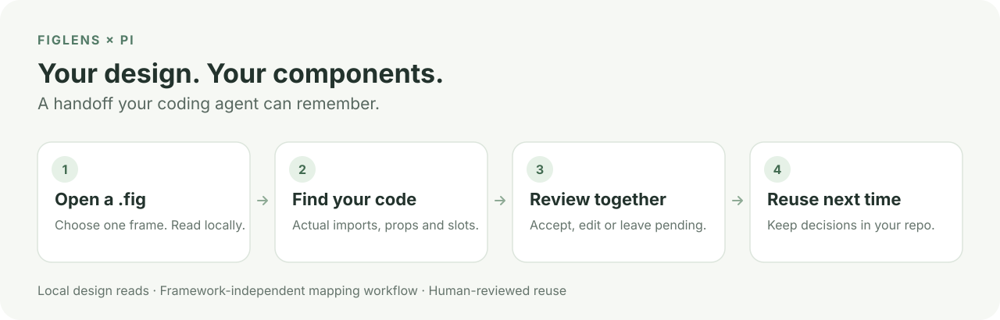
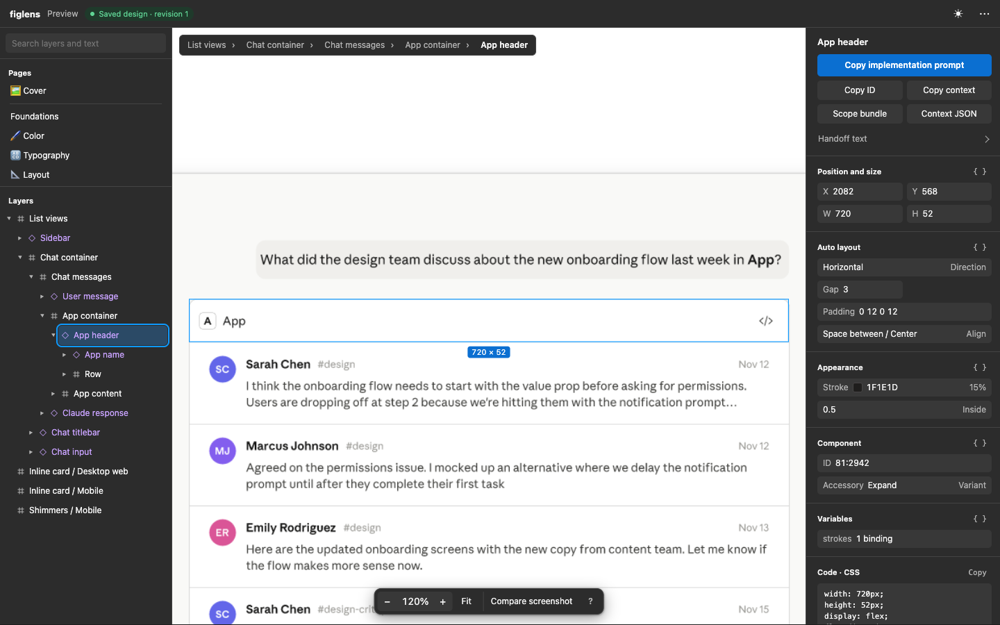

# figlens — Guía de uso

[← README](../README-es.md)

<p align="center">
  <a href="README.md">English</a> · <a href="README-de.md">Deutsch</a> · <a href="README-es.md">Español</a> · <a href="README-fr.md">Français</a> · <a href="README-ja.md">日本語</a> · <a href="README-ko.md">한국어</a> · <a href="README-pt-BR.md">Português</a> · <a href="README-zh-CN.md">简体中文</a> · <a href="README-zh-TW.md">繁體中文</a>
</p>

- [Instalación independiente](#install)
- [¿Por qué figlens en lugar del MCP oficial de Figma?](#why)
- [Qué recibe el agent](#bundle)
- [Extensión de Pi](#pi)
- [Explora un diseño sin Figma](#viewer)
- [Servidor MCP y skill para agents](#mcp-and-skill)
- [Referencia de la CLI](#commands)

<a id="install"></a>

## Instalación independiente

**¿Sin Node.js?** Instala el binario independiente y usa `"command": "figlens", "args": ["mcp"]` en su lugar:

| Plataforma | Comando |
|---|---|
| macOS / Linux | `curl -fsSL https://raw.githubusercontent.com/runkids/figlens/main/scripts/install.sh \| sh` |
| Homebrew | `brew install runkids/tap/figlens` |
| Windows (PowerShell) | `irm https://raw.githubusercontent.com/runkids/figlens/main/scripts/install.ps1 \| iex` |

<a id="why"></a>

## ¿Por qué figlens en lugar del MCP oficial de Figma?

Usa **figlens** cuando el diseño deba viajar como archivo: agents remotos, CI, trabajo sin conexión, traspaso entre agents, lecturas repetidas sin límite. Usa el **MCP oficial de Figma** cuando el agent deba ver el diseño en vivo sin un paso de exportación.

| | figlens | MCP oficial de Figma |
|---|---|---|
| Fuente | Snapshot `.fig` exportado | Archivos de Figma en vivo |
| Requiere | El archivo | Inicio de sesión en Figma; el servidor de escritorio requiere la app |
| Límites de uso | Ninguno, análisis local | Límites del servicio de Figma |
| Agent remoto / CI | Copia el archivo, ejecuta el binario | Servidor remoto con inicio de sesión |
| Cambios en el diseño | Exportar un nuevo `.fig` | Automático |
| Traspaso | Compartir el `.fig` o un bundle de frame | Compartir el acceso a Figma |
| Fidelidad | Parser independiente con [límites conocidos](../README-es.md#limitations) | Mantenido por Figma |

Leer un `.fig` funciona sin conexión. Instalar y actualizar figlens, las entradas `gs://`, tu proveedor de modelos y las dependencias de tu proyecto sí necesitan red.

<a id="bundle"></a>

## Qué recibe el agent

Un frame, un zip. Estructura para construir, recursos para usar, una imagen para comprobar.

```text
frame.zip
├── context.md                Start here: instructions for your agent
├── design/
│   ├── nodes.json            Layout, text, styles and expanded instances
│   ├── fonts.json            Font faces the visible text uses, with node ids
│   └── variables.json        Bound variables, collections, modes and aliases
├── assets/                   Image fills, SVGs and composited node renders
├── assets.json               Maps design references to asset files
├── references/screen.png     A render of the frame to compare against
├── missing-assets.json       Anything that could not be produced
└── manifest.json             File roles, media types, sizes and SHA-256 hashes
```

¿Necesitas una sola pieza? La CLI lo hace directamente:

```sh
npx -y @runkids/figlens find design.fig "login" --type FRAME     # ids de frame por nombre o texto
npx -y @runkids/figlens inspect design.fig 12:345                 # resumen compacto de layout y texto
npx -y @runkids/figlens nodes design.fig 12:345 > frame.json      # JSON con forma REST
npx -y @runkids/figlens export design.fig 12:345 icon.svg         # SVG, PNG, JPG, WebP o AVIF
npx -y @runkids/figlens bundle design.fig 12:345 frame.zip        # el zip de arriba
```

Las exportaciones SVG incrustan los image fills originales y convierten el texto en contornos de glifos, así que no hacen falta fuentes. A través de MCP, las exportaciones raster también se devuelven como imágenes inline, de modo que el agent ve el diseño sin abrir un archivo.

<a id="accuracy"></a>

### ¿Qué tan cerca está de Figma?

Medido contra las exportaciones JSON, PNG y SVG de la propia Figma en **826 frames de producción** y cinco archivos de la Community (2026-10-22):

| Comprobación | Resultado |
|---|---|
| Estructura de nodos, nombres, visibilidad, bounds y texto | Idénticos en 771 / 826 frames |
| Image fills originales | 2,608 / 2,608 idénticos byte a byte |
| Recursos SVG | 5,014 / 5,197 dentro del umbral de diferencia de píxeles |
| Bundles de frames de la Community | 306 / 306 sin recursos faltantes |

Resultados sobre esos archivos, no una garantía para todos los diseños. Método y umbrales: [informe de precisión](../wiki/accuracy.md).

<a id="pi"></a>

## Extensión de Pi

```sh
pi install npm:@runkids/figlens
```

Guías de instalación: [OpenCode V2](../opencode/README.md) · [OMP](../omp/README.md).

Reinicia Pi o ejecuta `/reload`, y luego pide una pantalla con tus propias palabras. Pi encuentra el frame, lo lee a través del servidor MCP registrado automáticamente y construye con tu stack. Sin ids de nodo, sin CLI global.

Pedir un texto o una pantalla busca directamente en el `.fig` y no guarda nada. Para búsquedas repetidas, pide a Pi que active un índice para un diseño y un ámbito: prepara una vez un índice local (sin comando de configuración), informa del trabajo hasta que está listo y lo reutiliza tras reinicios y en otros hosts. Restablecer ese índice requiere que lo pidas explícitamente. Preguntar dónde se usa un componente, una variable, un estilo o una imagen lista sus usages exactos de la misma forma: directamente desde el `.fig` o, una vez activado, desde ese índice. Pedirle a Pi que siga los cambios de un diseño hace track de ese ámbito, preparando su índice si hace falta, e informa qué cambió desde la última revisión; una pregunta sobre dos copias guardadas se responde con `diff` sin iniciar nada. Detalles: [índice local](#local-index).

- `/figlens plan <request>` solo crea un plan; no modifica la aplicación.
- `/figlens yolo <request>` planifica, construye, comprueba y limpia su propio plan temporal.
- `/figlens preview [description]` abre el viewer local.
- `/figlens review` aprueba los mapeos de componentes reutilizables que propuso el agent.



Guía completa, comandos y límites: [pi/README.md](../pi/README.md).

<a id="viewer"></a>

## Explora un diseño sin Figma

[](../assets/pi-demo.mp4)

```sh
npx -y @runkids/figlens preview design.fig                        # viewer local, Ctrl+C para detener
npx -y @runkids/figlens preview design.fig 12:345 --out preview.html   # snapshot HTML offline para enviar a cualquiera
```

Explora páginas y capas, busca, usa la búsqueda clasificada y los usos exactos de la selección, mide, inspecciona layout, tipografía, variables y CSS, exporta cualquier capa, copia un prompt de implementación o descarga un bundle de la selección. Suelta una captura de pantalla de tu build para superponerla al diseño. Detalles: [guía de preview](../wiki/preview.md).

<a id="mcp-and-skill"></a>

## Servidor MCP y skill para agents

**MCP.** El servidor se ejecuta en local por stdio y expone `workflow`, `tree`, `find`, `search`, `usages`, `diff`, `inspect`, `nodes`, `variables`, `bundle`, `verify`, `index`, `jobs`, `changes`, `watch`, `export` y `models`. Pasa rutas absolutas. Añade `--root /path/to/designs` (repetible) para limitar todas las rutas de archivos y de salida a las carpetas elegidas. El almacenamiento de índices fuera de los directorios predeterminados de figlens requiere `--storage-root DIR` (repetible). Las exportaciones raster se reducen a `maxSize` (por defecto 1600 px) para que las imágenes inline sean pequeñas; SVG devuelve solo metadatos.

Con `workflow`, el agent puede leer las guías integradas `build`, `audit`, `images`, `plan`, `planning-details` o `yolo` cuando se solicite expresamente. Comparten las fuentes del skill portable; instalarlo aparte es opcional para MCP. El agent realiza el trabajo con sus herramientas de proyecto y navegador y los permisos del host. Leer una guía no ejecuta el flujo; su uso depende del cliente y del comportamiento del modelo.

Windows nativo con Claude Code: sigue sus [notas de configuración stdio](https://code.claude.com/docs/en/mcp#option-3-add-a-local-stdio-server) y el wrapper `cmd /c` para `npx`.

**Skill.** El [skill de figlens](../skills/figlens/SKILL.md) enseña a un agent a encontrar frames, leer el bundle en piezas pequeñas, planificar trabajo acotado y verificar la UI en ejecución contra el diseño. Instala solo instrucciones; la CLI o el servidor MCP deben estar disponibles. Instálalo con la [Skills CLI](https://github.com/vercel-labs/skills) o copia `skills/figlens/` en el directorio de skills de tu agent (Claude Code: `~/.claude/skills/`):

```sh
npm install -g @runkids/figlens
npx skills add runkids/figlens --skill figlens
```

**skillshare.** Gestiona el skill y la conexión MCP en Claude Code, Codex y Cursor desde un solo lugar con [skillshare](https://github.com/runkids/skillshare):

```sh
skillshare install github.com/runkids/figlens/skills/figlens
skillshare mcp add figlens --global --target claude --target codex --target cursor --no-tui -- npx -y @runkids/figlens mcp
skillshare sync && skillshare sync mcp --global
```

**Notas de instalación.** El launcher de npm descarga el binario nativo correspondiente en el primer uso, lo verifica con los checksums SHA-256 de la release y lo guarda en caché. Las instalaciones por script se actualizan con `figlens update`; las de Homebrew, con `brew upgrade figlens`. Los binarios cubren macOS (Apple silicon, Intel), Linux (arm64, x86_64, musl estático) y Windows (x86_64). Cada vía de instalación también coloca `figlens-embed`, el runtime de la [búsqueda semántica opcional](#semantic-search), junto a `figlens`; no carga ningún modelo hasta que configures uno.

<a id="local-index"></a>

## Búsqueda ordinaria e índice local opcional

|  | Ordinario (por defecto) | Avanzado: índice local (opcional) |
|---|---|---|
| Qué hace | Lee el `.fig` en cada llamada y responde `search`, `find`, `inspect` y `export`. | Construye una vez un índice de búsqueda de un ámbito elegido y responde `search` desde él, con ranking entre fuentes. |
| Qué se escribe | Ningún workspace ni base de datos de índice (`export` solo escribe los archivos que pidas). | Un workspace local (base de datos SQLite) en el directorio de estado del usuario, o en el `--storage` elegido. |
| Cuándo usarlo | Preguntas puntuales, scripts, CI. | Búsquedas repetidas en un archivo; varios archivos de un proyecto como un solo corpus (`--workspace <dir>`); usos exactos de componentes, variables, estilos e imágenes. |

Una pregunta de diseño normal nunca crea un índice. Lo activas una vez, de forma explícita («crea un índice para este diseño»); figlens elige el almacenamiento y no requiere SQLite ni otra configuración.

```sh
# Ordinario: sin estado, no crea nada
figlens search design.fig "checkout button"

# Avanzado, una vez: elige un ámbito (un id de nodo, o 0:0 para todo el archivo); la construcción corre en primer plano
figlens index prepare design.fig --scope 0:0

# Búsqueda indexada; añade --node si el ámbito indexado no es todo el archivo
figlens search --file design.fig "checkout button" --node 0:0

# Tras editar o reexportar el .fig: reconstruye solo los ámbitos cuyos bytes cambiaron
figlens index refresh --file design.fig

# Tras mover el .fig: conserva el workspace y luego refresh (usa el workspaceId que imprime prepare)
figlens index relocate <sourceId> new/design.fig --id <workspaceId>
figlens index refresh --id <workspaceId>
```

MCP: `index` prepare devuelve un job; consulta `jobs` hasta `succeeded` y busca con el `workspaceId` de la respuesta.

```json
{"tool": "index", "arguments": {"action": "prepare", "file": "/abs/path/design.fig", "scope": "0:0"}}
{"tool": "jobs", "arguments": {"action": "status", "jobId": "<jobId from the reply>"}}
{"tool": "search", "arguments": {"workspaceId": "<workspaceId from the reply>", "node": "0:0", "query": "checkout button"}}
```

Ciclo de vida: `refresh` reconstruye solo los ámbitos cuyos bytes del `.fig` cambiaron; `rebuild` reconstruye aunque no haya cambios; `clear_cache` borra solo datos que una construcción puede recrear y conserva el registro y los índices publicados; `reset` borra la base de datos de este workspace (nunca el `.fig` ni las exportaciones) y solo se ejecuta a petición explícita. Nuevas fuentes, un ámbito más amplio, reset y recrear exigen cada uno su propia petición explícita.

¿Moviste el `.fig`? `index relocate` conserva `workspaceId`, `sourceId` y el almacenamiento; después haz `refresh` de los ámbitos afectados. No hay autodescubrimiento ni fusión por hash, y no hace falta reset.

¿Varios diseños en una carpeta? `index add <dir> --workspace DIR` registra en un solo paso hasta 10 archivos `.fig` de ese directorio y omite los enlaces que salen de él; la respuesta indica `added`, `existing`, `skipped` y `truncated`, repetirlo no añade nada y cada archivo sigue necesitando su propio `prepare --scope`. Un archivo movido dentro de la carpeta es una fuente nueva, salvo que uses `relocate`. Pasa el `nextCursor` de la respuesta como `--cursor C` (MCP `cursor`) para añadir los 10 siguientes. Los cursores paginados de búsqueda y librería duran una hora; después devuelven `cursor_expired`, así que busca de nuevo.

Datos: la base de datos SQLite contiene rutas locales registradas, nombres de capas y texto efectivo de los ámbitos elegidos, postings de búsqueda, relaciones exactas (contención, instancias, variantes, enlaces de variables/estilos/imágenes, destinos de prototipo) y las definiciones a las que apuntan, hashes, generaciones y jobs. El `.fig` original permanece sin cambios donde está; sus bytes sin procesar no se guardan en la base de datos.

Pi, OpenCode y OMP usan el mismo índice mediante su propia entrada opt-in, y el workspace se reutiliza entre reinicios y hosts. No implementado: eventos de archivo (un watch sondea el archivo, y solo mientras un holder se ejecuta), vectores y eventos push.

<a id="semantic-search"></a>

## Búsqueda semántica opcional

Experimental. `figlens search <file> <query> --mode semantic|hybrid` ordena las capas por significado con un modelo local. El `--mode text` por defecto no cambia y no necesita modelo.

- **Configuración única.** Descarga tú mismo BAAI/bge-m3 en la revisión `5617a9f61b028005a4858fdac845db406aefb181` (MIT; `config.json`, `pytorch_model.bin`, `tokenizer.json`): figlens nunca descarga. `figlens models configure bge-m3 --model DIR [--runtime FILE]` comprueba los archivos con SHA-256, inicia una vez el runtime `figlens-embed` sin conexión (se busca junto al ejecutable de figlens salvo que des `--runtime`) y guarda el perfil en `models.json` del directorio de configuración. `models list|status` lo muestran; `models remove bge-m3` lo olvida y conserva los archivos.
- **Modos.** `semantic` ordena cada capa por su mejor fragmento de nombre, texto, propiedades de componente o ámbito. `hybrid` fusiona los rankings de texto y semántico (Reciprocal Rank Fusion). Sin perfil, `semantic` falla con `mode_unavailable` y `hybrid` devuelve los resultados de texto e indica el motivo. `coverage.layers.semantic` informa `ready`, `partial` o `unavailable`; una página parcial no tiene `nextCursor`. El modelo usa solo CPU (unos 2,5 GiB de memoria); Ctrl-C lo detiene.
- **Límites.** Se incrustan nombres de capa, texto efectivo, los valores de propiedades de componente de una instancia (un valor que no se resuelve con exactitud se omite y se cuenta) y los nombres de página y contenedores de cada capa. La búsqueda con `--workspace`/`--id` lee la capa de modelo almacenada de cada fuente y nunca incrusta texto de diseño; se crea con `figlens index embed` (el servidor MCP la encola tras una compilación de texto). Una fuente sin ella queda `pending` y la página es parcial. En el conjunto de pruebas congelado de esta función, el modelo no alcanzó el umbral de calidad para consultas de sinónimos y propósito (tasa de top-1 erróneo 0,25, umbral 0,20); trata los resultados como pistas.
- **MCP.** La herramienta `models` (`list`, `status`, `configure`, `remove`) y `mode` en `search`; `configure` solo ejecuta el `figlens-embed` junto a figlens, y el directorio y los archivos del modelo deben estar dentro de las raíces del servidor. Cancelar la llamada detiene una búsqueda o configuración en curso.

<a id="commands"></a>

## Referencia de la CLI

| Comando | Salida |
|---|---|
| `tree <file> [node] [--depth N] [--json]` | Ids, tipos REST (como en `nodes`) y nombres de nodos; texto con sangría, o JSON anidado con el tamaño de cada nodo, si está oculto y el modo de auto layout, más `firstText` (primer texto visible) en los nodos de una página o sección |
| `tree <file> [node] --top-frames [--json]` | Solo las pantallas, una por línea, listas para `--frames -`: frames, componentes, conjuntos de componentes e instancias de una página o de sus secciones (se omiten grupos y páginas internas); `--json` añade los ids de página y sección y el primer texto visible de cada pantalla (`firstText`), que distingue las etiquetas del lienzo de las pantallas |
| `find <file> <query> [--type TYPE] [--node ID] [--limit N]` | Búsqueda sin distinguir mayúsculas en nombres de capas y texto; rutas, tamaños y vistas previas. 20 resultados por defecto (1-200) |
| `search <file> <query> [--node ID] [--type T[,T]] [--limit N] [--cursor C] [--include-hidden] [--include-internal] [--mode text\|semantic\|hybrid]` | Búsqueda clasificada en nombres de capas y texto completo con overrides de instancias, propiedades de texto/booleanas y swaps aplicados; referencias exactas de nodos (incluidos ids de subcapas `I…;…` para `inspect`), motivos de coincidencia, rangos UTF-16, cobertura y páginas con cursor. 20 por defecto (1-200); las capas ocultas y las páginas internas necesitan su flag. Con `--file`/`--workspace`/`--id` en lugar de `<file>` lee el índice preparado del workspace (ver `index`) `--mode semantic\|hybrid` necesita un modelo configurado: consulta [Búsqueda semántica opcional](#semantic-search). |
| `models list\|status\|configure <profile> --model DIR [--runtime FILE]\|remove <profile>` | Modelo de texto local para la búsqueda semántica (`bge-m3`, experimental); `configure` comprueba los archivos que descargaste y nunca descarga; `remove` los conserva. Consulta [Búsqueda semántica opcional](#semantic-search). |
| `usages <file> <node\|resource> [--scope ID] [--relation R[,R]] [--out] [--snapshot S] [--include-hidden] [--limit N] [--cursor C]` | Relaciones exactas de una capa o recurso (`VariableID:…`, `StyleKey:…`, `image:…`) en un ámbito guardado, con instancias anidadas y swaps: dónde se usa un componente, set, variable, estilo o imagen (por defecto) o a qué apunta una capa (`--out`). Cada resultado conserva su referencia exacta, relación, estado (`resolved`, `missing`, `unresolved`, …), base y evidencia; un nombre nunca cuenta como identidad. Sin totales: la cobertura dice completa o parcial. Por defecto 50 (1-200). Con `--file`/`--workspace`/`--id` en lugar de `<file>` lee el índice preparado de `--scope` del workspace. Con `--out`, un uso de una copia en caché de biblioteca también indica su `library` {kind, namespace, key}. |
| `usages --file\|--workspace\|--id … --library <kind> --namespace <ns> --key <key> [--definition-source ID --definition-snapshot SNAP --definition-node NODE] [--source ID] [--scope ID] [--include-hidden] [--limit N] [--cursor C]` | Capas que usan un componente, estilo o variable de biblioteca (`kind`), tal como lo registra la copia en caché de cada archivo, en el `--scope` preparado de todas las fuentes (`--source` limita a una). La definición queda `unresolved` salvo que las tres opciones `--definition-*` la seleccionen por referencia exacta (`selected`, `keyEvidence: unverified`); la cobertura indica el estado de cada fuente y por qué es parcial. Tómala del campo `library` de `usages --out` sobre una capa que la use. |
| `diff <old.fig> <new.fig> [--node ID] [--limit N] [--cursor C] [--json]` | Qué cambió entre dos revisiones guardadas: una línea por cada frame de primer nivel con cambios, con recuentos por faceta (texto, layout, apariencia, propiedades, estructura, vinculaciones); `--json` añade valores de campo antiguos/nuevos y cambios de edges. Las capas solo coinciden por id y tipo exactos; un frame con el mismo nombre o posición es solo un possible match etiquetado, y un lado que se detuvo antes, o una capa cuya única diferencia es un campo que no se pudo leer, informa unknown, nunca eliminado ni cambiado. Páginas de 100 cambios (1-500) |
| `inspect <file> <node> [--depth N] [--images] [--states] [--compare-variant ID] [--flat]` | Resumen compacto de layout/texto expandido, como máximo 200 nodos. `--images` añade dimensiones de bitmap y áreas de recorte. `--flat` imprime en su lugar una línea por nodo: posición relativa al nodo, tamaño, texto, fuente, relleno, trazo, radio, auto-layout |
| `nodes <file> <node>` | El objeto por nodo de una respuesta REST de nodes (`document`, `components`, `componentSets`, `styles`): instancias expandidas y overrides, auto-layout, estilos de texto, fills, efectos, variables enlazadas, propiedades de componentes, render bounds |
| `nodes <file> --frames <list>`, `--frames -` (stdin), `--ids <node>...` | Una decodificación, muchos nodos: una línea JSON por id listado, la salida de `nodes` con su `nodeId`, o `{nodeId, error}` |
| `variables <file> [node]`<br>`variables <file.fig> --format dtcg --collection ID --mode ID --out FILE` | Por defecto: variables vinculadas/locales en formato REST sin cambios. Exportación DTCG 2025.10: IDs exactos de colección y modo, sin nodo; solo colores y números sin unidad. Crea primero el directorio de salida; cualquier diagnóstico cancela la exportación completa sin modificar el archivo de salida. |
| `bundle <file> <node> <out.zip> [--states]` | Un bundle de diseño para un frame; imprime `{nodeId, path, warnings}` |
| `bundle <file> --frames <list> --out-dir <dir> [--jobs N] [--states]`, `--frames -` (stdin) | Muchos bundles a partir de una sola decodificación, en paralelo |
| `verify <bundle>` | Comprueba un bundle (`.zip` o su directorio extraído) contra su manifiesto: archivos verificados, ausentes y modificados, assets que faltan, las fuentes que hay que confirmar en el proyecto y `findings`: cada entrada de handoff ausente, no soportada o no verificada, con sus nodos, evidencia y siguiente acción |
| `export <file> <node> <out> [--bounds layout] [--scale N] [--quality 1-100] [--max-kb N] [--max-size N] [--match-dir DIR]` | SVG, PNG, JPG, WebP o AVIF; `--max-kb` reduce la calidad con pérdida hasta que quepa; `--bounds layout` exporta la caja de layout en lugar de los límites de render; `--match-dir DIR` (solo SVG, con subcarpetas) lista los SVG que dibujan los mismos contornos (`matches`) y hasta 10 formas similares con puntuación (`similar`) |
| `export <file> --frames <list> --out-dir <dir> [--format F] [--scale N] ...`, `--frames -` (stdin) | Una decodificación, muchas exportaciones (por defecto `png`): escribe `<dir>/<nodeId>.<format>`, una línea JSON por id, la salida de `export` con su `nodeId`, o `{nodeId, error}` |
| `preview <file> [node] [--out preview.html] [--port N] [--bind IP]` | Viewer local de solo lectura; `--out` escribe un snapshot offline independiente; los resultados y el context copiado indican la página y, en vivo, la ruta del archivo, el snapshot del source cargado y la revision local (desconocidos offline, donde la ruta nunca se incrusta); el context incluye también la coverage del scope de referencia, `complete: null` si no se comprobó |
| `compare <file> <nodes.json> <node>` | Diff contra una exportación REST del mismo frame |
| `node <file> <node>` | Un nodo `.fig` sin procesar |
| `index prepare\|refresh\|rebuild\|clear\|status\|add\|remove\|relocate\|reset\|track\|untrack\|embed` | Workspace local en el directorio de estado de figlens del usuario, o bajo un `--storage DIR` que el workspace recuerda después. `prepare <file> --scope NODE` construye una vez el índice de búsqueda de ese ámbito; luego `search --file <file>` (o `--workspace DIR`) responde sin volver a analizar, con ranking conjunto de las fuentes del workspace. `refresh` reconstruye los archivos cambiados, `rebuild` todos o una `--source`/`--scope`, `clear` elimina índices sin uso; el índice anterior sigue sirviendo hasta que el nuevo está listo. `reset` elimina solo la base de datos del workspace, nunca diseños, exportaciones ni la ubicación recordada. `track --scope NODE` registra los cambios de ese scope desde un build baseline; `untrack` lo detiene y conserva el historial. `embed` incrusta los ámbitos publicados con el modelo configurado (CPU y memoria); ejecútalo solo si quieres búsqueda semántica en el workspace. |
| `jobs status\|cancel <jobId>` | Ver o cancelar una construcción de índice; `cancel` vuelve cuando la construcción se detuvo |
| `changes --file <file>\|--id ID\|--workspace DIR [--source ID] [--scope NODE] [--consumer NAME\|--subscription ID\|--cursor C] [--revision R] [--limit N]` | Cambios registrados de los scopes seguidos, del más antiguo al más reciente: una revisión por build publicado (baseline o changes) con cobertura y recuentos por tipo de cambio y faceta; cada revisión changes tiene un resumen `impact` de las capas que alcanzan sus cambios (null antes del esquema 7); `--revision` pagina los nodos cambiados de esa revisión y luego las capas que lista su impacto (`entry` indica cuál); `tracking` indica cuándo un scope necesita `index refresh` para registrar un cambio. Solo lectura |
| `watch ack --file <file>\|--id ID\|--workspace DIR --consumer NAME\|--subscription ID --cursor C [--source ID] [--scope NODE]` | Mueve el checkpoint de un consumidor al `nextCursor` de la última página de `changes` que procesó con los mismos filtros; repetirlo es seguro y solo avanza, salvo que un cursor de recuperación actual retrocede un checkpoint que quedó tras un borrado para releer las revisiones conservadas; un cursor emitido antes de que la retención borrara revisiones que no había pasado es `event_gap` y no escribe nada |
| `watch run --file <file>\|--id ID\|--workspace DIR --scope NODE [--source ID] [--request-id R]` | Mantiene en primer plano un lease sobre un scope rastreado: el runner compartido del workspace lo actualiza en cada guardado (sondeo cada 250 ms, verificación de contenido cada 60 s), así `changes` muestra revisiones nuevas sin `index refresh`. Imprime el lease y luego una línea final cuando se cierra stdin, con Ctrl-C o SIGTERM, o cuando el scope deja de rastrearse. MCP `watch` `start` y `stop` mantienen leases mientras el servidor se ejecuta; un lease sin renovar termina a los 30 s y el runner sale tras el último |
| `watch status --file <file>\|--id ID\|--workspace DIR` | Los leases del workspace (`active`, `unauthorized`, `untracked`, `expired`, `ended`) y su runner (`running`, `stopping`, `stopped`, `unknown`, con su ubicación); nunca escribe |
| `watch subscribe --file <file>\|--id ID\|--workspace DIR --consumer NAME --source ID [--scope NODE] [--node ID] [--owner NAME]` | Sigue una fuente, un scope o una capa exacta (`--node`) desde su revisión más reciente con su propio checkpoint, leído con `changes --subscription` y confirmado con `watch ack --subscription`; una capa ausente o ambigua es `target_missing` o `identity_uncertain`, nunca otra con el mismo nombre; `--owner` la hace temporal para esa tarea |
| `watch subscribe --file <file>\|--id ID\|--workspace DIR --consumer NAME --source ID --query TEXT [--type T[,T]] [--scope NODE]` | Guarda una búsqueda sobre el scope de una fuente: sus 50 primeros se evalúan ya; `changes --subscription` lee las evaluaciones guardadas y nunca calcula una |
| `watch subscribe --file <file>\|--id ID\|--workspace DIR --consumer NAME --sources visible\|ID[,ID] --query TEXT\|--library KIND --key KEY [--namespace NS] [--definition-source ID --definition-snapshot SNAP --definition-node NODE]` | Guarda una búsqueda, o los usos de un elemento de biblioteca con su `definitionMatch`, sobre un conjunto fijo de hasta 10 fuentes (`visible` se resuelve ahora; nunca se añaden fuentes posteriores): `delta.changedSourceIds` nombra las fuentes con bytes nuevos, `corpus_changed` un cambio del conjunto, `coverage.transitive` es `not_followed` y `delta.notFollowedSourceIds` nombra las fuentes cambiadas sin usos, cuyos dependientes no se revisaron; eliminar un miembro la desactiva (unsubscribe y luego subscribe de nuevo) |
| `watch evaluate --file <file>\|--id ID\|--workspace DIR --subscription ID` | Guarda la evaluación de una suscripción de consulta sobre el índice actual del scope, salvo que ya esté evaluada; un watch sobre el scope lo hace tras cada publicación |
| `watch list --file <file>\|--id ID\|--workspace DIR [--consumer NAME] [--after ID] [--subscription ID]` | Lista las suscripciones visibles y su estado, una página cada vez; `--subscription` lee solo esa (vacío si no es visible) |
| `watch unsubscribe --file <file>\|--id ID\|--workspace DIR --subscription ID\|--consumer C --owner NAME` | Quita una suscripción y su checkpoint, o las temporales de un owner; el tracking y el historial se mantienen |
| `watch forget --file <file>\|--id ID\|--workspace DIR --consumer NAME [--source ID] [--scope NODE]` | Quita los checkpoints sueltos de un consumer; un consumer guarda como máximo 64 suscripciones y checkpoints y un workspace 4096, y nada se desaloja automáticamente |
| `mcp` | Servidor MCP local por stdio |
| `update` | Reemplaza el binario por la última release |

Para variantes de componentes relacionadas, usa `inspect --states` o `bundle --states` (MCP: `states: true`, false por defecto; sin cambiar la configuración). La evidencia conserva marcas de origen, datos desconocidos y truncamiento. Los bundles añaden `design/states.json` y un resumen en `context.md`. Consulta el alcance y los límites en [evidencia de estados](../wiki/states.md).

Compara dos variantes del mismo component set con `inspect <file> <variantA> --compare-variant <variantB>` (MCP `compareVariant`). `variantComparison` muestra diferencias de campos y conjuntos de valores almacenados, con IDs de origen y datos desconocidos, sin emparejar nodos hijos. Consulta los [límites](../wiki/states.md#compare-two-variants).

Un argumento de nodo acepta `12:345`, `12-345` o una URL de Figma con `?node-id=`. `<file>` también puede ser `gs://bucket/object`, descargado con tu login de `gcloud` y guardado en caché. Consulta la [guía de snapshots en GCS](../wiki/gcs.md) para la entrega mediante un objeto fijo, los permisos necesarios y los límites de actualización. Cada llamada a la CLI decodifica el archivo; MCP solo reutiliza el último archivo local sin cambios. Las llamadas remotas vuelven a analizarlo. Ejecuta `figlens --help` o `figlens inspect --help` (también `-h`) para ver el uso completo de la CLI. `index add gs://bucket/object` registra una copia fijada de esa generación e informa `remote {uri, generation}`; solo add ejecuta gcloud.

`inspect` incluye el ajuste de tamaño del texto, el truncamiento, el máximo de líneas y la decoración registrados. Un padre sin auto-layout lleva `childSpacing: "derived"`: los espacios entre sus hijos son diferencias de coordenadas, no una regla de auto-layout; `constraints` aún puede fijarlos. `handoffDiagnostics` informa de semántica guardada pero no emitida, con recuentos, ejemplos y [límites de cobertura](../wiki/semantics.md#known-handoff-gaps). Las salidas protegen el origen y reemplazan el destino tras completar la escritura. MCP limita las líneas de solicitud a 1 MiB y las respuestas completas a 8 MiB; si se supera el límite, devuelve un error explícito. El JSON completo sigue disponible mediante la CLI.
