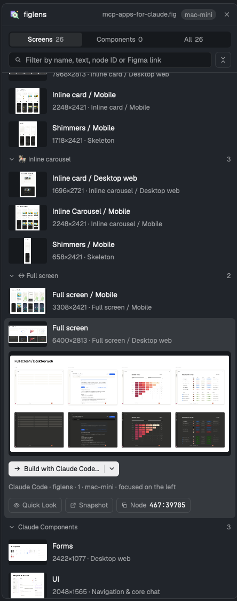

# figlens for Herdr

A [Herdr](https://herdr.dev) panel for Figma `.fig` and FigCraft `.figcraft`
designs beside your agents. Open a design, find a screen or any layer (by name,
text, node ID or a pasted Figma link), look at it full size, and hand it to the
agent in the pane on the left as **Build**, **Plan** or **YOLO**, always after a
confirm dialog that shows the exact message. It runs the matching CLI on the
machine that holds the design, so a remote design never has to move just to
read or preview it.



Two shareable folders:

- [`figlens/`](figlens/), the mod: `mods/figlens/`, the [`RECIPE.md`](figlens/RECIPE.md)
  another agent can build it from, and `preview.png`.
- [`figlens-layout/`](figlens-layout/), the "Herdr + figlens" layout: Herdr's
  default window with a figlens button in the tab bar that opens the panel
  where Files and Changes open; the button or the close button at the panel's
  top right hides it ([`RECIPE.md`](figlens-layout/RECIPE.md)).

## Install

No figlens CLI install is needed for Figma `.fig` files. The panel uses
`figlens` on PATH, else the copy `npx @runkids/figlens` caches, else it offers
a one-click download of the matching release, checked against its SHA-256 sums.
For FigCraft `.figcraft` files, install `figcraft-cli` on the machine holding
the design and make it available on PATH or at `~/.local/bin/figcraft-cli`;
FigLens does not download it.

Ask the agent running in Herdr, for the layout (the button and panel are in place when it opens):

```text
Read ~/.config/herdr-app/AGENTS.md, then add this layout: https://github.com/runkids/figlens/tree/main/herdr/figlens-layout
```

or for the mod alone:

```text
Read ~/.config/herdr-app/AGENTS.md, then add this mod: https://github.com/runkids/figlens/tree/main/herdr/figlens
```

By hand: copy `figlens/mods/figlens/` to `~/.config/herdr-app/mods/figlens/`
and run `herdr-app check ~/.config/herdr-app/mods/figlens`. Without the layout,
open it beside your terminal:

```sh
herdr-app do pane.split --direction right --mod figlens
```

For the layout, also copy `figlens-layout/layouts/herdr-figlens.json` and
`herdr-figlens.png` to `~/.config/herdr-app/layouts/` and run
`herdr-app do layout.switch --name herdr-figlens`; `ctrl-shift-l` switches back.

## Use

- **Open** a design: drop a `.fig` or `.figcraft` on the panel, click to choose
  one, or pick a supported design found near the focused pane (on its machine).
  Each Herdr space remembers its own design, and a saved design reloads by itself.
- **Find**: Screens, Components or All; filter by name or first text. Type a
  Figma node ID (`12:345`) or paste a Figma link, or type a numeric FigCraft node
  ID, to jump to that node and its screen; other text searches every indexed
  layer. Pages fold; the button beside the filter folds or opens them all.
- **Look**: select a row for a large preview. **Quick Look** (Space, or a
  thumbnail) opens a floating window at full size; ← → move between screens.
  For Figma, **Browser** opens the figlens viewer at that node, or an offline
  snapshot when the design is on another machine; the viewer stops by itself
  after 10 minutes with no page open. For FigCraft, **Open in FigCraft** opens
  the design in the FigCraft app (a remote file is fetched first). **Point** sends the agent on the left a reference to it
  (file, node, screen) after a confirm; the agent says what it is and waits for
  what you want done.
- **Hand over**: the split button builds with the agent focused on the left;
  its menu holds Plan, YOLO, Start in a new tab and Copy prompt. Pi and
  OpenCode receive their own `/figlens plan` and `/figlens yolo` commands,
  Claude Code the figlens MCP `workflow` guide (or `figlens workflow` when
  its session has no figlens MCP), any other agent a plain prompt naming the
  skill's reference. A shell is never a receiver. YOLO confirms only by click.
- **Agents**: when agents use figlens in Herdr terminals (its MCP server or
  the CLI) with a Figma design, a line under the filter shows what each agent
  read last, and previews mark those reads. FigCraft reads are not in figlens's
  activity journal, so this live activity view is Figma-only.
- **Board** (beside List in the header): every screen by what agents did with
  it: Changed since built (the design was saved again and that screen changed
  since an agent worked on it), Building (its agent is working on it, or needs
  you), Done · not verified (its agent finished a turn), Planned (an agent you
  asked to plan it finished; pick it to build), Verified (checked with figlens compare_image, with
  its mismatch), Read before, Not started. Thumbnails open Quick Look to watch,
  without actions. A banner above names the newest changed screen; **Send changes**
  gives its agent the changed layers after a confirm. Pick screens and
  plan them with the agent on the left (one message, one screen at a time) or
  **Plan each in a new tab** (side by side); picks that are all Planned are
  built the same ways; **Compare** opens a verified screen's design
  beside the build screenshot (or the differences), and **Ask … to fix** sends
  what the comparison found to an agent after a confirm. With FigCraft, the
  Board still tracks handoffs made by this panel, but Changed since built,
  activity-based states, Verified, Compare and Ask to fix require FigLens's
  journal/diff APIs and are not available.
- **Keys** on the panel: `/` filters, ↑ ↓ move, Enter builds, Space looks closer, Esc clears.

When the design and the agent are on different machines, the confirm dialog
says so and copies the design to the agent's machine first, once per saved
version, under `~/.cache/figlens/herdr-designs/`. FigCraft previews are
exported on the design's machine, and its converted node tree is fetched once
per saved revision for layer search; opening a remote FigCraft design fetches
a local copy for the FigCraft app.

## Privacy

Everything stays on your machines. The panel runs figlens where the design is,
keeps thumbnails and previews in its own folder under `~/.config/herdr-app`, and
contacts the network only for the one-click engine download from GitHub
Releases. It runs `figlens` and, for FigCraft designs, `figcraft-cli` on the machine
that holds the design; `hc` sends confirmed messages and copies designs between
Herdr machines; `open` or `xdg-open` opens fetched FigCraft files. It also runs
`osascript`,
`zenity` or `kdialog` for the file picker, `open` or `xdg-open` for a
snapshot, and `sh` with its standard tools (`stat`, `find`, `dd`, `du`, `wc`, `tar`,
`gzip`, `gunzip`, `mktemp`, `touch`, `realpath`, `sha256sum` or `shasum`,
`awk`, `cp`, `ls`, `rm`, `tail`, `head`, `base64`, `env`, `tr`), plus `curl`
for the download. For Changed since built it
keeps each saved version of an open design (a copy-on-write clone where the
file system has one, else a full copy; the newest 8 per design) under
`~/.cache/figlens/herdr-revisions/`. The cache row at the bottom of the empty
panel shows and clears what it keeps, including figlens's render cache, design
copies and kept versions, after a confirm. When agents use figlens inside a
Herdr terminal (MCP or CLI), each call that read the design is recorded: the
design's path and saved version, the tool, node ids and the screen box, and
for a comparison its numbers and the screenshot and diff paths (no names, text
or images), in figlens's state folder under `activity/`, at most about 512 KiB
per design. The panel reads it there; outside Herdr nothing is
recorded. Lines older than a week are removed; delete that folder to clear
it. Herdr's shared state keeps what the board needs: each screen the panel
handed to an agent (screen id, intent, the agent's terminal or tab name; a
week) and what agents read in the last 10 minutes. A host that filters its MCP servers' environment (Codex's `env_vars`) must
pass `HC_TERMINAL_ID`, or its agents do not show.

## Development

```sh
node --test herdr/tests/*.test.mjs
herdr-app check herdr/figlens/mods/figlens
```

The tests cover the engine download, the screen list, node references, the
messages each agent receives, that the layout folder's mod matches
`figlens/mods/figlens/`, and that the mod's figlens version is the release
version. Rendering needs Herdr itself: `herdr-app check`.
