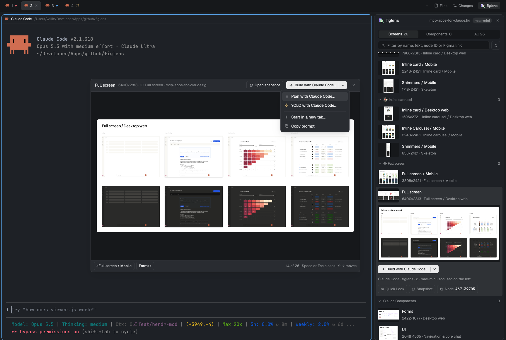

# Herdr + figlens

Herdr's default window with a figlens button in the tab bar beside Files and Changes. It opens the figlens panel where those panels open, so a design sits beside your agents: find a screen or layer and hand it to the agent on the left.

## What you see

Left to right, everything as in Herdr's `main` layout ("Herdr"), plus two blocks:

- **Sidebar**, 268px: the brand bar, Spaces and Agents, and the footer, all Herdr's own `workspace-chrome`, `spaces` and `agents` mods.
- **Work column**: the tab bar row, now `tabs` (weight 1) beside a 96px `figlens-toggle` block drawing the figlens button; then the shown tab as cards, and the side panel whose stack holds Herdr's `files` and `changes` and the figlens panel; then the status bar.
- The figlens panel is the mod in `mods/figlens/`; its own `RECIPE.md` describes the panel, its dialogs and Quick Look.

## How it behaves

- Agent status shows as in Herdr's default window; figlens hands a design to the agent focused on the left.
- The figlens button opens the side panel on figlens (`layout.select {stack: "panel-body", child: "figlens"}`, `layout.show {id: "panel"}`) and closes it when it is already showing, exactly as Files and Changes do. Drag the boundary to resize the panel.
- The panel behaves as its recipe says.

## Built from

- `layouts/herdr-figlens.json`: a `layout.clone` of `main` (Herdr 0.1.12, `cloned_from` recorded) with two changes:
  - the tab bar block becomes `{ "id": "tabs-row", "type": "row", "size": { "px": 42 }, "resizable": false, "children": [ the tabs block with "size": { "weight": 1 }, { "id": "figlens-toggle", "type": "block", "content": { "mod": "figlens", "props": { "role": "toggle" } }, "size": { "px": 96 } } ] }`;
  - `panel-body` gains `{ "id": "figlens", "type": "block", "content": { "mod": "figlens" } }`.
  Root `"preview": "layouts/herdr-figlens.png"` is the picture Settings shows.
- `mods/figlens/`: the figlens mod, unchanged.
- Shipped mods it uses: `workspace-chrome`, `spaces`, `agents`, `tabs`, `pane`, `files`, `changes`, `workspace-status`.
- Its look is Herdr's: no theme or fonts of its own.

## Watch out

- The figlens mod reaches the network only to download its engine from GitHub Releases, and runs `figlens` and `hc`; see its recipe. The rest of the layout is Herdr's own.
- A layout clone is never updated: a later Herdr may change `main`. Rebuild from this recipe on a new version rather than keeping an old clone.
- The shipped tabs mod remembers Files or Changes per space, not figlens: switching spaces while figlens shows may close the panel.
- If a `figlens` mod is already installed, rename this one and the `mod` names in the layout.

## Done when

- `herdr-app check mods/figlens` passes and `layout.switch {name: "herdr-figlens"}` shows the layout with no `herdr-figlens.error`.
- The tab bar shows Files, Changes and figlens; figlens opens the panel there and a second click closes it.
- `ctrl-shift-l` cycles back to the person's own layout.
