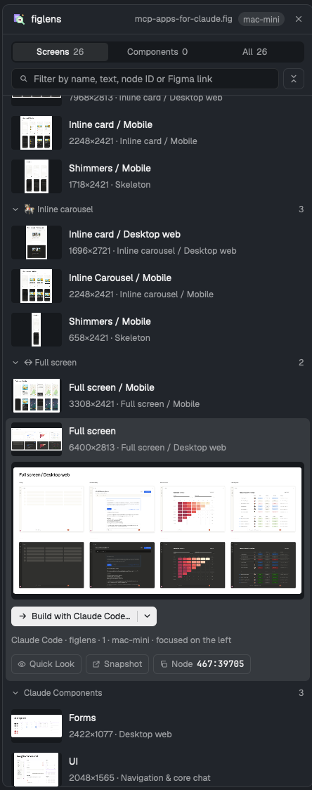

# figlens

A panel that reads a local Figma `.fig` beside your agents. Open a design, find a screen or any layer by name, text, node ID or Figma link, look at it full size, see which screen each agent is reading, point the agent on the left at it, and hand it to the agent in the pane on the left as Build, Plan or YOLO after a confirm dialog that shows the exact message. figlens runs on the machine that holds the design, and the panel needs no figlens install.

## What you see

A card in the theme's `background`, `border` outline, radius 10. Every size is relative to the person's `ui_font_size` (base, 13 by default): title base + 1 semibold, body base + 0.5, secondary and buttons base − 0.5, labels base − 1 semibold, dialog titles base + 2. Secondary text is `muted`; `dim` only draws dividers and icons. Buttons are 28 high, radius 6: primary in `solid`/`solid_foreground`, secondary outlined in `border`.

- **Header**, 42 high: the figlens mark (`mark.svg`, 18 px) and `figlens`, the open file's name right-aligned in `muted`, a machine pill (`selected` fill, radius 10) when the file is on another Herdr machine, a 24 px close icon button for the design (tooltip `Close design`), and, where the layout has a side `panel`, a 1 px `border` divider after it and a 24 px close icon button that hides the panel (`layout.hide {id: "panel"}`, tooltip `Hide panel`), shown with no design open too.
- **Toolbar**, pinned under the header once screens are known: a segmented control `Screens n · Components n · All n`, then a 30 px filter field (search icon, placeholder `Filter by name, text, node ID or Figma link`, `n of N` and a clear icon while it has text) and a 30 px fold-all icon button.
- **Agents**, at the bottom of the toolbar while live agents read this design in the last 10 minutes: one 24 px row each, newest first: an 8 px dot in the agent's color (`ansi4`, `ansi5`, `ansi6`, `ansi3`, `ansi2`, `ansi1` by agent order), the program name semibold, `tool · screen · page` (or `node <id>`, or `the file`) in `muted`, and `now`, `12s` or `3m`. A row with a known screen is clickable. On the preview each agent's box carries a 15 px tag in its color, `<agent> · <tool>`. Under the list, `Activity on this file`: up to 8 lines, newest first (dot, agent, tool in the terminal font, screen · page, how long ago).
- **Header views**: a 2-button segmented control `List | Board` after `figlens` once screens are known.
- **Change banner**, under the toolbar while a worked-on screen changed: a `chrome` card with a refresh icon in `ansi3`, `<screen> changed in <file>`, `<agent> worked on it <ago> ago; n layers changed: a, b, c`, `Later` and `→ Send changes to <agent>…`.
- **Board**: sections `Changed since built` (`ansi3`, rows `n layers changed · <agent> worked on it <ago> ago` and `Send…`), `Building` (`working`; `needs you` while its agent is blocked), `Done · not verified` (`ansi4`, its agent finished a turn), `Planned` (`ansi5`, a plan's agent finished; can be picked to build), `Verified` (`ansi2`), `Read before`, `Not started`, each a 28 px header (dot, name, count) over 60 px rows: a 72×48 thumbnail (click: Quick Look, as does a row that cannot be picked), name, a `muted` line (`working · 6m`, `needs you · 2m`, `finished 5m ago · check it with compare_image`, `planned 1h ago · pick it to build`, `1.8% mismatch · 1 regions · 4m ago`, `inspect 3h ago`, or `w×h`), an agent pill, and `Compare` on verified rows with a screenshot. Planned, read-before and not-started rows have a 14 px checkbox; with any picked, a 44 px footer pinned above the status bar: `n screens selected`, `Clear`, and with an agent on the left `→ Plan with <agent>…` for one screen, or `Send all to <agent>…` (one message, one screen at a time) beside `+ Plan each in a new tab…` (side by side) for several; with no agent on the left only new tabs. When every pick is planned the buttons say Build instead of Plan.
- **Compare window**, 1000×680: `<screen> · design vs build`, `mismatch · outside text · regions · checked by <agent> <ago> ago`, `Show differences`, close; Design and Build (or Differences) panes side by side on `chrome`; the screenshot path in the terminal font and `→ Ask <agent> to fix…`.
- **List**, scrolling: page rows (chevron, name, a 7 px dot per agent reading a screen on that page, folded or not, count; 30 high) fold and unfold. Screen rows are 60 high: a 72×48 thumbnail well in `chrome` (a dashed outline until drawn; click: Quick Look with its actions), the name with a 7 px dot per agent reading that screen, and `w×h · first text`. A selected row opens below it: a preview as wide as the panel (up to 360 high) with a 2 px box in each agent's color around the layer it read there, the split button `→ Build with <agent>… | ▾`, a line naming the receiver (`Claude Code · space · tab · machine · focused on the left`), and quiet tools `Quick Look`, `Browser` (or `Snapshot`), `Point` (with a receiver), `Node <id>`.
- Typing text also lists `Layers inside screens` (type, text or name, screen · page). A node ID or Figma link shows one node card instead: type pill, name, `in <screen> · <page> · w×h`, and the same details.
- **Nothing open**: a dashed 104 px target `Open a .fig file / Drop it here or click to choose`, then `Near your focus · <folder>` (and a machine pill, and a refresh icon that scans again) listing up to 20 `.fig` files as name and folder; `Follow focus` after picking a folder. Pinned at the bottom: `Images x MB · figlens y MB · copies z MB` and a trash icon button.
- **Engine needed**: `figlens needs its engine on <machine>`, what is downloaded and where (`~/.cache/figlens/npm/<version>`, shared with npx), `Download figlens <version>`; `Downloading…` with a spinning ring; an error and `Try again`.
- **Reading**: six skeleton rows. **Gone**: an alert, `This file is no longer there`, `Open another file`.
- **Status bar**, 34 high, when there is something to say: an icon and text in `ansi2` (done), `muted` (info), `working` with a spinning ring (`Reading…`, `Drawing thumbnails · n of N`, copy and snapshot progress), or `ansi1` (error).
- **Dialogs** (Herdr's confirm look: `popover`, 18 padding, 32 px buttons, radius 8, `Esc` hint): the confirm dialog (`Send “X” to Codex?`, `Plan “X” with Pi?`, `Let Claude Code build “X” on its own?` with a `working` bolt note), the receiver card with its status pill, the message in the terminal font, then Cancel and the action. The new-tab dialog lists installed agents, `Plan / Build / YOLO`, the exact first message, and `Open tab with <agent>`. The clear-cache dialog lists what goes and `Clear n MB`.
- **Handoff menu**: a popup under the caret in Herdr's menu style (31 px rows, 14 px icons): `Plan with <agent>…`, `YOLO with <agent>…`, a rule, `Start in a new tab…`, `Copy prompt`.
- **Quick Look**: a floating window, 920×660: name, `w×h · page · file`, the browser button, the split button and close; the screen at up to 1600 px on `chrome`, with each live agent's box and `<agent> · <tool>` tag on it, moving as the agents read (from the panel through shared `figlens.live.v1`); opened from the board or the agents' line it only watches (`watch`: no browser or split button); `‹ prev`, `next ›`, and the agents on this screen (dot, name, tool, node, how long ago) or `n of N · Space or Esc closes · ← → moves`, or progress and errors.
- **Toggle** (`props: { role: "toggle" }`): `mark.svg` and `figlens` in the tab bar, styled as the tabs mod's Files and Changes; `selected` while the panel shows. It adds `figlens` to Herdr's shared `workspace.panels` once, so the tabs mod restores the panel per space like Files and Changes.

## How it behaves

- Agent status plays no part in the list; the board takes each screen's state from the journal, the panel's own handoffs (moved on by the 5 s poll with `handoffStep`, kept 7 days) and that agent's Herdr status (`boardState`). The receiver is only the agent focused on the left (Herdr's `agents()`), else the last one that was, since the panel's own keyboard focus takes focus away; a shell never receives.
- **Open**: drop, the system picker (`osascript` on macOS, `zenity` or `kdialog` on Linux, else a folder), or a nearby file. Each space keeps its own design in `shared("figlens.files.v1")`. A local design reloads on save (`watchFolder` on its folder; other files saved there do not reload it, and a reload happens only when the design's `stat -L` changed); a remote one is polled every 10 s.
- **Engine**: `figlens` on PATH on the design's machine, else `~/.cache/figlens/npm/<VERSION>/figlens` there, else the download button. The download fetches the release archive and `SHA256SUMS`, checks the hash, extracts, and renames into place.
- **Screens**: `tree --json --depth 1` and `tree --top-frames --json` on the design's machine. Over 40 rows the pages start folded; a filter opens them all.
- **Images**: thumbnails only for screens in open pages of the shown kind, in list order, 12 per `export --frames` here or 40 per remote batch (sent back as one base64 tar.gz), at scale 3 and at most 216 px. Images use `--bounds layout` (the node's own box). Previews (960 px) and Quick Look (1600 px) scale a small node up so it stays sharp. Images are kept per file revision; only the newest 12 revisions stay. All the panel's figlens runs share one queue: at most 2 at once, at most 1 of them background work (changed-since-built diffs), the open screen's preview first; queued work for a design that was closed or saved again is dropped (a run already started finishes, since Herdr's `exec` cannot stop it).
- **Find**: `inspect` resolves an ID or link, then `find` by name (and type, and text for text layers) places it in its screen. Other text runs `find` for layers after a 300 ms pause.
- **Hand over**: every intent opens the confirm dialog. Enter confirms Build and Plan; YOLO only by its button. A blocked agent cannot receive (a paste could answer its question). On confirm, `hc send` pastes the message, the notice reads `Sent to …`, and Herdr focuses that agent. Pi and OpenCode get `/figlens plan|yolo <request>`, Claude Code the figlens MCP tool `workflow` with that topic (not its own Workflow tool), or `<cli> workflow <topic>` without the figlens MCP server, others a plain prompt naming the skill's `planning.md` or `yolo.md`.
- **Across machines**: when the design and the receiver are on different machines, the dialog says it copies the design first; the copy goes to `~/.cache/figlens/herdr-designs/<key>/` on the receiver's machine, once per saved version, and the message points at it. The CLI path is only named on the design's own machine.
- **Point**: the confirm dialog (`Point <agent> at “X”?`) shows `Look at this in the Figma design <file>: <the layer or frame, node, page, screen>. Read it with figlens …, say in a line what it is, then wait for what I want done with it.`; `Send to <agent>` sends it like Build (`hc send`, Enter confirms), and the notice reads `Pointed <agent>`. A remote design is copied to the agent's machine first, as for Build.
- **Browser**: a local design starts `figlens preview` once as a hidden `hc run --bg` terminal and opens `<url>#node=<id>`; closing the design or the panel ends it, and with a figlens that has `--idle-exit` it is started with `--idle-exit 600`, so it also stops after 10 minutes with no page open. A remote design gets an offline snapshot made there and copied here.
- **New tab**: Herdr's `knownAgents()`; `tab.new` with the agent's argv and the chosen intent's message, in this space. From the board it opens on the footer's intent (Build when every pick is planned).
- **Cache**: the bottom row measures this panel's images, figlens's render cache (`figlens cache`) here and on the focused machine, design copies and kept versions (`~/.cache/figlens/herdr-designs/` and `herdr-revisions/`); the trash button opens a confirm dialog, then clears all of them and every panel reloads.
- **Agents**: every 5 s, on the design's machine and each machine with agents, `ACTIVITY` (in `journal.js`) prints, from figlens's activity journal (`<state>/activity/<first 16 hex of SHA-256 of the realpath>.jsonl` and its rotated `.1.jsonl`), each terminal's and each screen's newest line, each screen's newest comparison and the last 40 lines: for the design on its own machine, for its copy under `~/.cache/figlens/herdr-designs/` on the others. `parseActivity` reads them (a terminal there is addressed `<machine>/<id>`), `latestActivity` keeps each terminal's newest from the last 10 minutes, `recentActivity` feeds the activity list and `screenStates` the board; only terminals in `agents()` show. Clicking a row opens that screen in Quick Look.
- **Notices**: done and info notices leave after 4 s; errors stay until the next action.
- **Keys**: `/` focuses the filter, ↑ ↓ move between screens, Enter builds, Space opens Quick Look, Esc clears the filter, then the selection. Enter in the filter selects the first screen.

## Built from

- **One mod**, `mods/figlens/`. `mod.json`: `{ "place": "none", "title": "figlens", "focusable": true }`. As a pane: `pane.split {direction: "right", mod: "figlens"}`; in a layout as a block (the "Herdr + figlens" layout puts it in `panel-body` and a `{ role: "toggle" }` copy in the tab bar).
- `main.js`: the panel and its roles from `props().role`: `toggle`, `confirm`, `newtab`, `menu`, `clear`, `quicklook`, `compare` (`openOverlay` dialog, popup and window). `gpui-kit` `div`, `image`, `svg`; `gpui-base` `h_flex`, `v_flex`, `InputState` + `Input`. Sizes from `S()` over `settings().ui_font_size`, colors from `theme()`.
- `engine.js` (no Herdr imports): `VERSION` (Release Please bumps it), the release asset per platform, the npm cache folder, and the install script.
- `frames.js` (no Herdr imports): pages and screens, thumbnail names, fitting, one-line design strings, `nodeRef` for IDs and Figma links, the message for each intent and agent (including point, fix and update), `boardState`, `handoffStep`, `changedFrames`, `scopeChange`, `isRevision`, `pct` and `ago`.
- `journal.js` (no Herdr imports): the activity journal: the `ACTIVITY` script, `parseActivity`, `latestActivity`, `recentActivity`, `screenStates`, `readJournals` (every machine's lines for the design and its copy) and `Journal` (what changed since the last read: share, redraw). `herdr/tests/journal.jsonl` holds lines written by figlens's own writer; a Rust test and the panel's tests both read it.
- `session.js` (no Herdr imports): `DesignSession`, the design read now, its revision and a generation number; work started for an older read is stale.
- `work.js` (no Herdr imports): the queue every figlens run goes through (`NOW`, `SOON`, `LATER`; stale jobs are dropped).
- `place.js` (no Herdr imports): where the design lives (`placeOf`): its `stat`, waiting for a save (watch here, poll there), scripts there and drawing nodes there (`export --frames`, or `REMOTE_EXPORT` sent back as a tar.gz).
- `store.js` (no Herdr imports): every `shared` key below, its shape and when old values go.
- `cache.js` (no Herdr imports): every path on disk below, keeping revisions, measuring and clearing.
- `mark.svg` (the figlens mark, full color via `image`), `icons/*.svg` (stroke icons tinted with `svg`).
- **Storage**: `shared` keys `figlens.files.v1` (design per space), `figlens.notice.v1`, `figlens.quicklook.v1`, `figlens.compare.v1`, `figlens.live.v1`, `figlens.handoffs.v1`, `figlens.viewers.v1`, `figlens.cleared.v1`, and `figlens` added to Herdr's `workspace.panels`; images under `~/.config/herdr-app/mods/figlens/.cache/` (comparisons under `compare/`); design copies under `~/.cache/figlens/herdr-designs/`; kept versions under `~/.cache/figlens/herdr-revisions/<key>/` (newest 8 per design).
- **Herdr functions**: `exec` (with `on` for other machines), `hc`, `run` (`layout.select`, `layout.show`, `layout.hide`, `agent.focus`, `tab.new`, `terminal.kill`), `agents`, `focused`, `spaces`, `panes`, `knownAgents`, `pickFolder`, `watchFolder`, `openOverlay`, `closeOverlay`, `shared`, `setShared`, `nextCommand`, `theme`, `settings`, `layout`, `window`, `appHome`, `home`, `props`.
- **Programs**: `figlens` (through `env -u HC_TERMINAL_ID`, so the panel's own calls never show as an agent's), `hc`, `sh`, `curl`, `tar`, `gzip`, `stat`, `find`, `du`, `dd`, `wc`, `gunzip`, `mktemp`, `touch`, `realpath`, `sha256sum` or `shasum`, `awk`, `tail`, `head`, `cp`, `ls`, `rm`, `base64`, the file picker, `open`/`xdg-open`.

## Watch out

- Never `cx.notify()` during render: work started from render (load, discovery, thumbnails) only sets state and spawns.
- Read block props with `props()`, not `init`'s argument. A panel clicked or given `pane.go` takes keyboard focus away from the terminal, so remember the last focused agent.
- `--max-size` only shrinks: draw small nodes with `--scale` or they blur.
- A remote command's output is cut at 8 MB, `hc file write` takes 8 MB and `hc put` 16 MB, and a mod's own file write is capped too: move large files in parts through `hc exec` (`dd … | base64` back, `dd | hc exec -i … cat >>` out) and let the shell write them.
- Herdr's default popup placement is wrong inside a floating window: place the menu from the caret's press position.
- A flex child holding wrapping text needs `min_w(0)`; a button in a column needs `self_start`, in a row `self_center`.
- Herdr's shipped layouts take no new docks: open the mod with `pane.split`, or use the "Herdr + figlens" layout.
- Not on Windows yet: the engine, discovery and copies use `sh`.

## Done when

- After an agent read a screen, saving a change to that screen in Figma lists it under Changed since built within seconds, with the banner; Send changes opens the confirm dialog with the changed layers.
- Board lists a screen an agent exports or bundles as Building (one it only inspected as Read before), as Done once that agent finishes a turn, and after `compare_image` on it as Verified with its mismatch; Compare shows the design beside the screenshot, and Ask to fix opens the confirm dialog.
- Picking one screen and Plan with <agent> opens the confirm dialog; once sent the screen is Building while the agent works, then Planned, and picking it again offers Build.
- Picking two screens offers Send all to <agent> (one message listing both) and Plan each in a new tab (two tabs).
- `herdr-app check mods/figlens` passes and `node --test herdr/tests/*.test.mjs` passes.
- Point on a selected screen opens the confirm dialog; Send makes the agent answer with what that node is.
- With no figlens anywhere, opening a design offers the download and then lists its screens.
- Dropping a `.fig` lists its pages and screens with thumbnails; a design on another machine does too, without being copied.
- Typing a node ID or pasting a Figma link shows that node in its screen; typing text lists matching layers.
- Selecting a screen shows a sharp preview; Quick Look opens it full size and ← → move.
- Build, Plan and YOLO each open a confirm dialog with the exact message; Send pastes it into the agent on the left; a shell is never offered.
- With the design and agent on different machines, the dialog says it copies first, and the agent opens the copied path.
- The trash button asks first, naming the kept versions apart, then clears the images, figlens renders, copies and kept versions.
- With an agent reading the open design with figlens in a Herdr terminal (its MCP server or the CLI), its row appears under the filter within 5 s, its screen gets a dot, and the preview outlines the layer it read; clicking the row opens Quick Look, where the box moves as the agent reads.
